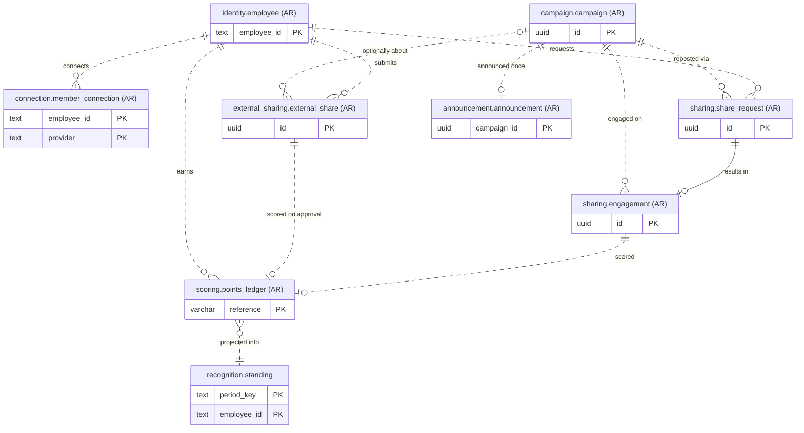
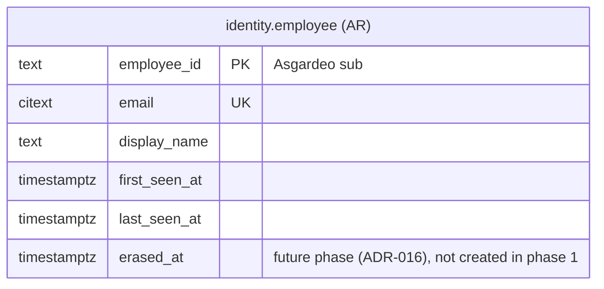
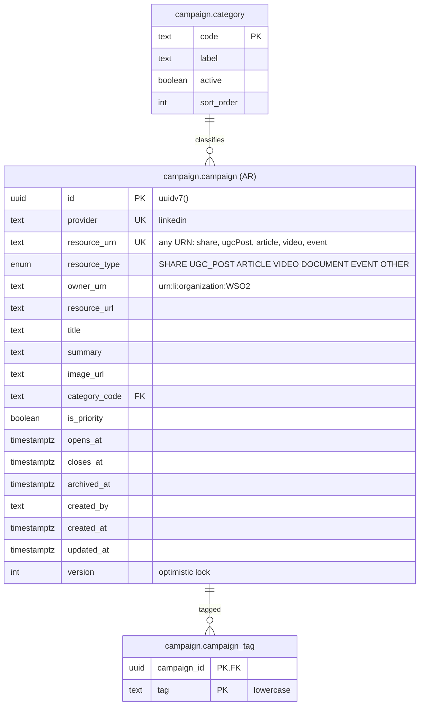
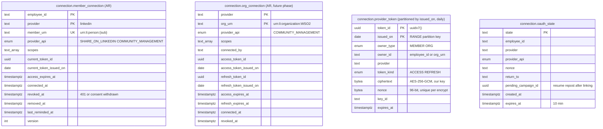
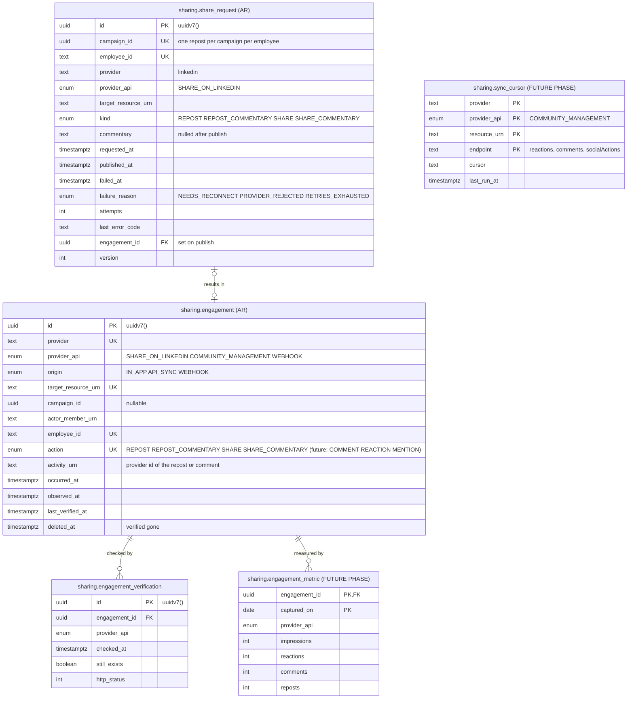
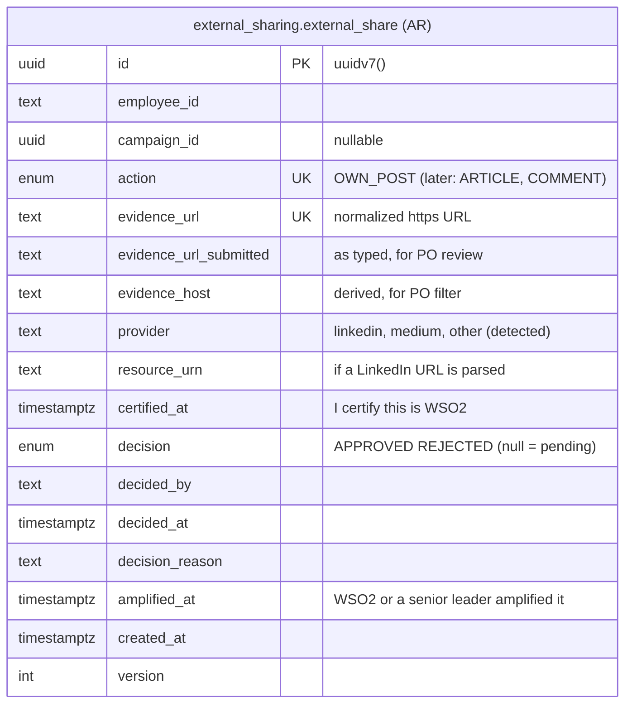
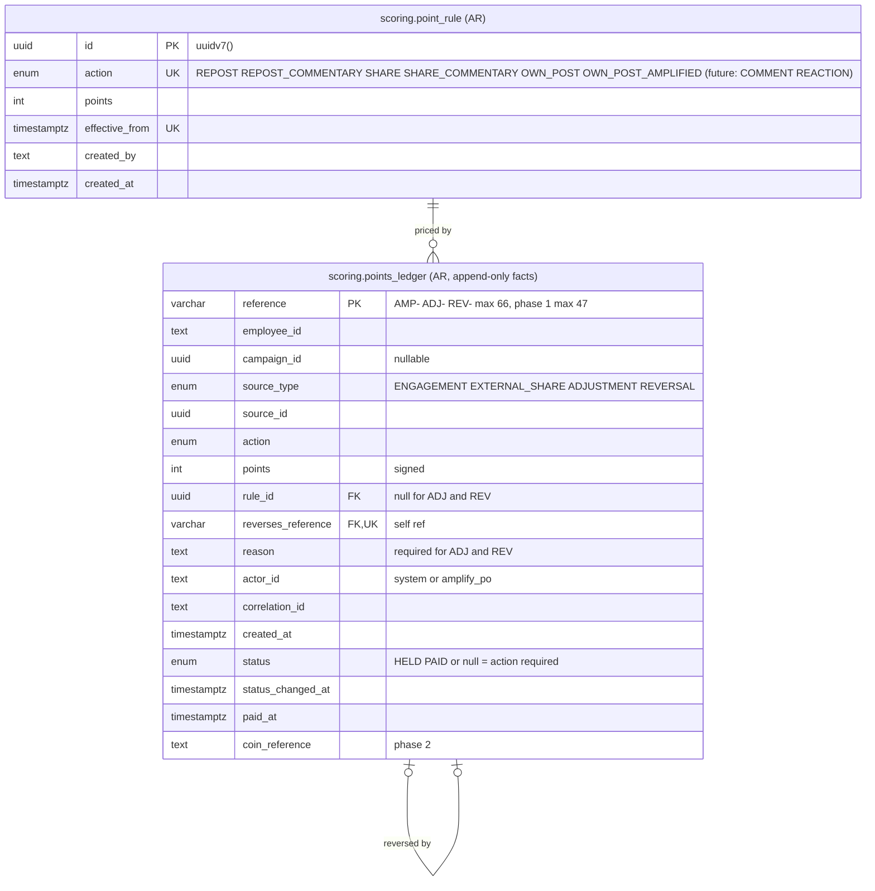
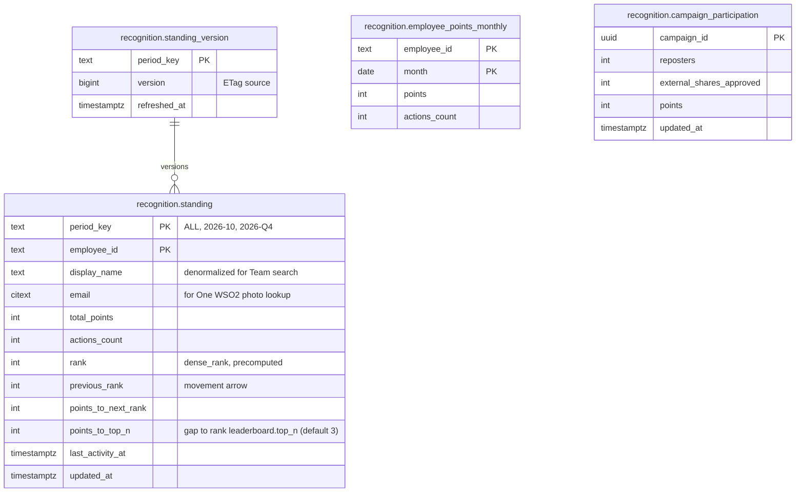
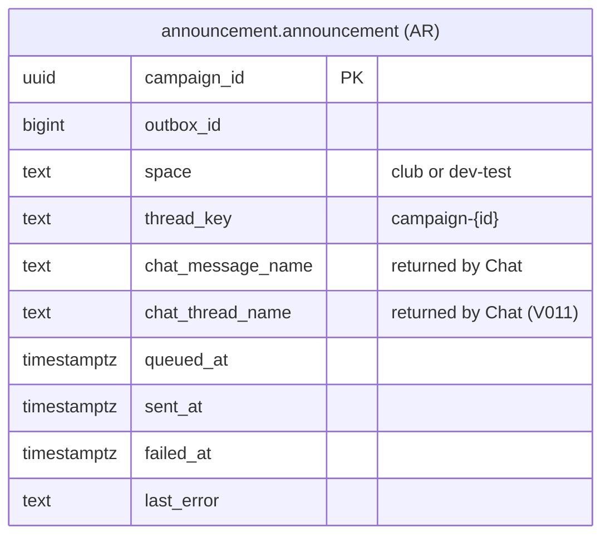
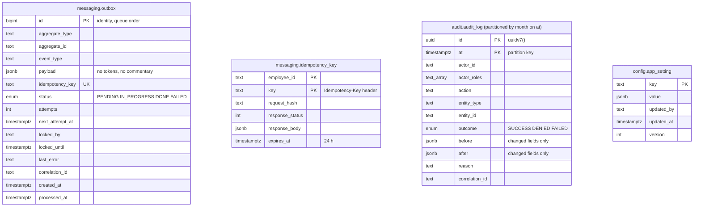

# amplify-database

Amplify DB Migrate: the Choreo Manual Task (and Compose one-shot) that builds the Amplify PostgreSQL 18 database. It applies `migrations/` (`V###__name.sql`), then `seed/` (`S###__name.sql`), in order, one transaction per script, and records each in `public.schema_version` with a checksum. It also sets the app role passwords from secrets, then exits. A rerun is a no-op, a changed applied script stops the run (forward-only), and `dryRun = true` only lists what would run.

| Folder | What |
| --- | --- |
| `main.bal` | The runner |
| `migrations/` | Forward-only schema scripts, `V001` to `V013` so far |
| `seed/` | Idempotent seed data (`ON CONFLICT DO NOTHING`): point rules, categories, app settings, scheduler settings (see `seed/README.md`) |
| `checks/` | One-off checks such as `d2_extensions.sql` (run on each new server, plan D2) |
| `tests/` | Unit tests plus the `integration` group (needs a migrated PostgreSQL 18, see `docs/migrations/README.md`) |

Run from this folder: `bal build`, `bal test`, `bal run`. Rules for writing scripts: never edit an applied migration, no `?` in scripts (the JDBC driver reads it as a bind marker), enums are `text` plus `CHECK`, views are `security_invoker`, and maintenance functions are `SECURITY DEFINER` with a pinned `search_path`. Details: `CLAUDE.md` in this folder.

> **The data model below is a copy** of [`architecture/solution/Phase 1/phase1-data-model.md`](../architecture/solution/Phase%201/phase1-data-model.md) (pasted 2026-10-21, relative links adjusted). That file is the source of truth. Change it first, then refresh this copy.

---

## WSO2 Amplify — Phase 1 Data Model (DDD)

Status: **Draft v2 for review** (2026-10-16)
Builds on: [phase1-domains.md](../architecture/solution/Phase%201/phase1-domains.md) · Plan: [phase1-planned-todos.md](../docs/requirements/phase1-planned-todos.md) (M3)
Database: **PostgreSQL 18** (Choreo-managed, Aiven), one database `amplify`.
Audit mitigations applied 2026-10-16 ([requirements-map.md](../architecture/solution/Phase%201/requirements-map.md), Audit B–D). Phase labels follow the requirements-map [Other phases](../architecture/solution/Phase%201/requirements-map.md#other-phases-refine-later) table: "phase 2" means the Coin issuer and SLT reports; Community Management work is "future phase" (D5).

## Contents

- [Design rules](#design-rules)
- [Context overview](#context-overview)
- [How status works](#how-status-works)
- [identity — shared kernel](#identity--shared-kernel)
- [campaign — S1 Campaign](#campaign--s1-campaign)
- [connection — S2 Connection](#connection--s2-connection)
- [sharing — C1 Sharing (core)](#sharing--c1-sharing-core)
- [external_sharing — S3 External Sharing ("My Campaign")](#external_sharing--s3-external-sharing-my-campaign)
- [scoring — C2 Scoring & Points Ledger (core)](#scoring--c2-scoring--points-ledger-core)
- [recognition — S4 Recognition (read models)](#recognition--s4-recognition-read-models)
- [announcement — S5 Announcements](#announcement--s5-announcements)
- [messaging, audit, config — infrastructure](#messaging-audit-config--infrastructure)
- [Domain events → which table changes](#domain-events--which-table-changes)
- [Database users and grants](#database-users-and-grants)
- [Decisions from review (2026-10-16)](#decisions-from-review-2026-10-16)

## Design rules

1. **One schema per bounded context.** A context's module reads and writes only its own schema. The schema is the boundary you could later lift into its own component (or database) without touching other contexts.
2. **No physical foreign keys across contexts.** They are **virtual FKs**: implied by name and type, enforced by the owning module and by domain events in `messaging.outbox`. Every diagram has a *Virtual FKs* table under it. Physical FKs exist only inside a context.
3. **Aggregate roots** are marked `AR`. Child tables belong to their root and are only changed through it.
4. **Invariants live in constraints** wherever Postgres can enforce them (unique keys, checks, column grants). The domain code enforces the rest.
5. **Identity is the Asgardeo `sub`** (`employee_id`, text). Email is an attribute and can change.
6. **No HR or photo data.** One WSO2 adds photo, team and department in the UI (ADR-009).
7. **Secrets never sit beside business data.** Tokens live in their own partitioned table, encrypted by the app.
8. **Facts, not flags.** Store *what happened and when* (timestamps, decisions). Status is **derived** in `*_v` views, so it can't drift. See [How status works](#how-status-works).
9. **Provider-agnostic.** Every external thing is `provider` + `provider_api` + a resource URN. The same tables serve **Share on LinkedIn** (phase 1), **Community Management** (future phase), webhooks, and other platforms later.
10. **Read models are pre-built tables**, kept current in the same transaction as each ledger insert (jobs score pass, or `amplify-api` for PO decisions and corrections, B12), so One WSO2 reads are single indexed lookups. See [recognition](#recognition--s4-recognition-read-models).
11. **Required extensions: `citext`** (`identity.employee.email`, `recognition.standing.email`) **and `pg_trgm`** (Team search). The M0 D2 check confirms both on a real Choreo database before M3 (B18). Portability rule: no other extension without an ADR. If either is missing, fall back to `text` + a `lower(email)` unique index, and `ILIKE` prefix search on a `lower(display_name)` btree index.

**IDs:** every `uuid` key defaults to **`uuidv7()`**, the native function in **PostgreSQL 18**. UUIDv7 is time-ordered, so new rows append to the end of the B-tree (no random-insert page splits), and `ORDER BY id` is roughly creation order. If an environment is ever below PG 18, generate v7 in Ballerina instead; never mix in v4.

**`text_array` in the diagrams = Postgres `text[]`** (a native array, not JSON). Mermaid doesn't allow `[]` in type names. Insert with `ARRAY['openid','profile','w_member_social']`; query with `'w_member_social' = ANY(scopes)`.

Legend: `||--o{` physical FK (same context) · `}o..||` virtual FK (no constraint) · `PK` / `FK` / `UK` keys.

## Context overview



| Schema | Context ([phase1-domains](../architecture/solution/Phase%201/phase1-domains.md)) | Tables | Written by |
| --- | --- | --- | --- |
| `identity` | shared kernel | `employee` | api |
| `campaign` | S1 Campaign | `campaign` (AR), `campaign_tag`, `category` | api |
| `connection` | S2 Connection | `member_connection` (AR), `org_connection` (AR, future phase), `provider_token` (partitioned), `oauth_state` | api, jobs |
| `sharing` | C1 Sharing | `share_request` (AR), `engagement` (AR), `engagement_verification`; *future:* `engagement_metric`, `sync_cursor` | api, jobs |
| `external_sharing` | S3 External Sharing (UI: "My Campaign") | `external_share` (AR) | api |
| `scoring` | C2 Scoring & Points Ledger | `point_rule` (AR), `points_ledger` (AR) | api, jobs |
| `recognition` | S4 Recognition | `standing`, `standing_version`, `employee_points_monthly`, `campaign_participation` | api (PO approve, amplify, adjust, reverse), jobs (score pass) (B12) |
| `announcement` | S5 Announcements | `announcement` (AR) | jobs |
| `messaging` | infrastructure | `outbox`, `idempotency_key` | api, jobs |
| `audit` | infrastructure | `audit_log` (partitioned monthly, 5-year retention) | api, jobs |
| `config` | infrastructure | `app_setting` | api |

**All virtual FKs in one place** (each section repeats its own):

| Domain | table.key | Domain | table.fk |
| --- | --- | --- | --- |
| identity | `employee.employee_id` | connection | `member_connection.employee_id`, `oauth_state.employee_id`, `org_connection.connected_by` |
| identity | `employee.employee_id` | campaign | `campaign.created_by` |
| identity | `employee.employee_id` | sharing | `share_request.employee_id`, `engagement.employee_id` |
| identity | `employee.employee_id` | external_sharing | `external_share.employee_id`, `external_share.decided_by` |
| identity | `employee.employee_id` | scoring | `points_ledger.employee_id`, `points_ledger.actor_id`, `point_rule.created_by` |
| identity | `employee.employee_id` | recognition | `standing.employee_id`, `employee_points_monthly.employee_id` |
| identity | `employee.employee_id` | audit / config | `audit_log.actor_id`, `app_setting.updated_by` |
| campaign | `campaign.id` | connection | `oauth_state.pending_campaign_id` |
| campaign | `campaign.id` | sharing | `share_request.campaign_id`, `engagement.campaign_id` |
| campaign | `campaign.(provider, resource_urn)` | sharing | `share_request.(provider, target_resource_urn)`, `engagement.(provider, target_resource_urn)` |
| campaign | `campaign.id` | external_sharing | `external_share.campaign_id` |
| campaign | `campaign.id` | scoring | `points_ledger.campaign_id` |
| campaign | `campaign.id` | recognition | `campaign_participation.campaign_id` |
| campaign | `campaign.id` | announcement | `announcement.campaign_id` |
| connection | `provider_token.(token_id, issued_on)` | connection | `member_connection.(current_token_id, current_token_issued_on)`, `org_connection.(…_token_id, …_issued_on)` |
| connection | `member_connection.(provider, member_urn)` | sharing | `engagement.(provider, actor_member_urn)` |
| sharing | `engagement.id` | scoring | `points_ledger.source_id` when `source_type = 'ENGAGEMENT'` |
| external_sharing | `external_share.id` | scoring | `points_ledger.source_id` when `source_type = 'EXTERNAL_SHARE'` |
| messaging | `outbox.id` | announcement | `announcement.outbox_id` |

---

## How status works

You asked whether status is set in code or by a trigger, and how it stays in sync. **Neither is stored where a timestamp already says it.**

| Kind of state | Example | Where it lives | Why it can't drift |
| --- | --- | --- | --- |
| **Time-driven** | campaign SCHEDULED / OPEN / CLOSED, connection EXPIRED | **Not stored.** Computed in a `*_v` view from `opens_at`, `closes_at`, `expires_at` vs `now()` | There's nothing to update when the clock moves |
| **Event-driven** | share PUBLISHED / FAILED, external share APPROVED / REJECTED, connection REVOKED / REMOVED | A **fact column** written by the owning module's code, in the same transaction as the event: `published_at`, `failed_at`, `decision` + `decided_at`, `revoked_at`, `removed_at`. The view derives status from those | One writer per aggregate, one transaction. `CHECK` constraints tie facts together (e.g. `decision` and `decided_at` both set or both null) |
| **Workflow / queue** | outbox PENDING / IN_PROGRESS / DONE | Explicit `status` column, set by code | It *is* the work-queue state that `SKIP LOCKED` claims on |
| **Settlement** | ledger HELD / PAID / null | Explicit `status` column (your rule), set by code. **Only** the settlement columns are updatable (column-level `GRANT UPDATE`) | `CHECK (status <> 'PAID' OR paid_at IS NOT NULL)` |

**No triggers** for business state. Triggers hide logic from the domain code and make Docker, Choreo and OpenChoreo behave the same only if every migration ran perfectly. The only database-side automation is constraints plus the partition upkeep job.

Example view:

```sql
CREATE VIEW campaign.campaign_v AS
SELECT c.*,
       CASE WHEN c.archived_at IS NOT NULL THEN 'ARCHIVED'
            WHEN now() <  c.opens_at        THEN 'SCHEDULED'
            WHEN now() <  c.closes_at       THEN 'OPEN'
            ELSE 'CLOSED' END AS status
FROM campaign.campaign c;
```

---

## identity — shared kernel



- Upserted by `amplify-api` on authenticated calls, so the leaderboard has a name and One WSO2 has an email to look up photo and team (ADR-009).
- Data deletion is **deferred to a future phase** (C3, ADR-016). Phase 1 builds no `EmployeeErased` handling and no `erased_at` column. The pilot runs under a security checklist exception (exception) with a manual interim process ([runbook](../docs/runbooks/data-deletion-interim.md)). The future design anonymizes rather than deletes, and still has to solve the immutable `points_ledger.employee_id`.

**Virtual FKs:** none outgoing. `employee.employee_id` is the parent of every `employee_id`, `created_by`, `decided_by` and `actor_id` column (see the overview table).

## campaign — S1 Campaign



**Virtual FKs**

| Domain | table.key | Domain | table.fk |
| --- | --- | --- | --- |
| identity | `employee.employee_id` | campaign | `campaign.created_by` |

| Invariant | Enforced by |
| --- | --- |
| One campaign per provider resource | `UNIQUE (provider, resource_urn)` |
| Resource belongs to the WSO2 page | domain check: `owner_urn` = configured WSO2 org URN |
| `closes_at > opens_at` | `CHECK` |
| Default window: `closes_at` = `opens_at` + `campaign.default_window_days` (30) when not given (C7) | domain, on create; `closes_at NOT NULL` |
| Delete = archive; earned points stay | no `DELETE` grant; `archived_at` set |
| Status SCHEDULED / OPEN / CLOSED / ARCHIVED | derived in `campaign.campaign_v` |
| Announced exactly once | `announcement.announcement` PK = `campaign_id` |

Indexes: `(opens_at DESC) WHERE archived_at IS NULL` for the Posts page two-week window; `campaign_tag (tag)`; `(is_priority, opens_at DESC) WHERE archived_at IS NULL`.

## connection — S2 Connection



**Virtual FKs**

| Domain | table.key | Domain | table.fk |
| --- | --- | --- | --- |
| identity | `employee.employee_id` | connection | `member_connection.employee_id` |
| identity | `employee.employee_id` | connection | `oauth_state.employee_id` |
| identity | `employee.employee_id` | connection | `org_connection.connected_by` |
| connection | `provider_token.(token_id, issued_on)` | connection | `member_connection.(current_token_id, current_token_issued_on)` |
| connection | `provider_token.(token_id, issued_on)` | connection | `org_connection.(access_token_id, access_token_issued_on)`, `(refresh_token_id, refresh_token_issued_on)` |
| campaign | `campaign.id` | connection | `oauth_state.pending_campaign_id` |

The token references are virtual **inside** the context on purpose: Postgres won't drop a partition that a foreign key points into. A missing token row means "reconnect needed".

**Derived status** (`connection.member_connection_v`): `REMOVED` if `removed_at`; `NEEDS_RECONNECT` if `revoked_at > connected_at` or `access_expires_at < now()`; `EXPIRING` inside `reminder_days`; else `ACTIVE`. A reconnect sets `connected_at`, `access_expires_at` and a new token pointer, and clears `revoked_at`.

**Token encryption (your question).** LinkedIn hands us a **plain opaque bearer token** over TLS; nothing about it is encrypted for us. **We** encrypt it before it touches the database:
- **AES-256-GCM** with **our** 256-bit key (Choreo secret, `key_id` per row), a random 96-bit nonce per encryption, and **AAD = `token_id | owner_id | provider`**, so a ciphertext copied onto another row fails to decrypt.
- **Yes, we decrypt before calling LinkedIn.** `amplify-jobs` decrypts in memory right before the call, sends it as `Authorization: Bearer …` over TLS, and drops the plaintext right after. The plaintext is never logged and never returned by any API. It never leaves the cell except to LinkedIn.
- Key rotation: new key gets a new `key_id`. Old-key rows re-encrypt under the active key in two places (deep review 2026-10-17): right after jobs opens one to post (`resealOnUse` → `connection:resealToken` + `PgTokenRepository.updateSeal`, guarded by the old `key_id`), and in a rotation pass inside the daily `POST /maintenance/partitions` (`connection:resealStaleTokens`, keyset pages over `sealedWithOtherKey`; the report's `token_rotation` says how many rows moved, were skipped or didn't open). An old key can leave the ring once the pass reports `DONE` with no failures and no row carries it; it no longer has to wait for partition drops.
- **The token row commits with the connection change.** `connection:completeConnection` puts the sealed token on `ConnectionChange.tokenToInsert`, and `PgConnectionRepository.save` inserts it first inside the connection's transaction, so a failed connection write leaves no orphan token row (api review H3).

**Token partitions (ADR-002; retention research is plan D7, open):**
- `PARTITION BY RANGE (issued_on)`, **one partition per day** (`provider_token_p20261016`, …), created 7 days ahead.
- PK `(token_id, issued_on)` because Postgres requires the partition key in every PK/UNIQUE.
- **Drop rule works for any token life:** a day's partition is dropped when `max(expires_at)` in it `+ token_grace_days (5) < now()`, or when it's empty. Member access tokens (~60 days) clear their day at ~65 days. A day holding a future Community Management **refresh token** (~1 year) survives until that token is past expiry + grace.
- Upkeep: `DETACH PARTITION` then `DROP` (plain, not `CONCURRENTLY`: that can't run inside the `SECURITY DEFINER` function; the day dropped is old, so the lock is brief), via the scheduler (ADR-026) → `amplify-jobs POST /maintenance/partitions` once a day (`maintenance.schedule`); each drop is audited. **This is the only token-drop rule** (B11): no age-based drop anywhere, so a long-lived refresh token is never deleted early. The same daily call also handles audit partitions, the outbox purge and the `oauth_state` sweep (B10, see [infrastructure](#messaging-audit-config--infrastructure)).
- Reconnect and Remove Connection **delete the old token row right away**. The partition drop is the backstop.
- Backups keep dropped days until backup retention ends. That window is the true maximum time at rest, and it goes in the security checklist.

| Invariant | Enforced by |
| --- | --- |
| One connection per employee per provider | PK `(employee_id, provider)` |
| One employee per provider member | `UNIQUE (provider, member_urn)` |
| Token never stored in plaintext | app encryption; `amplify_readonly` has no grant on `provider_token` |
| State single-use, short-lived | `DELETE … RETURNING` on use; jobs sweep expired rows |

## sharing — C1 Sharing (core)

The split: **`share_request` is the command** ("Amplify, repost this for me"). **`engagement` is the fact** ("this employee did this action on this resource"), wherever it came from: an in-app repost today, Community Management sync or a webhook tomorrow. **Scoring only reads facts.** That's how the same tables serve any API.



**Virtual FKs**

| Domain | table.key | Domain | table.fk |
| --- | --- | --- | --- |
| campaign | `campaign.id` | sharing | `share_request.campaign_id` |
| campaign | `campaign.id` | sharing | `engagement.campaign_id` |
| campaign | `campaign.(provider, resource_urn)` | sharing | `share_request.(provider, target_resource_urn)` |
| campaign | `campaign.(provider, resource_urn)` | sharing | `engagement.(provider, target_resource_urn)` |
| identity | `employee.employee_id` | sharing | `share_request.employee_id` |
| identity | `employee.employee_id` | sharing | `engagement.employee_id` |
| connection | `member_connection.(provider, member_urn)` | sharing | `engagement.(provider, actor_member_urn)` |
| campaign | `campaign.(provider, resource_urn)` | sharing | `sync_cursor.(provider, resource_urn)` *(future)* |

**Derived status** (`sharing.share_request_v`): `PUBLISHED` if `published_at`; `FAILED` if `failed_at`; else `QUEUED`. `engagement_v` adds `ACTIVE` / `DELETED` from `deleted_at`. These are the share states every doc uses (B14); there is no `PENDING` share state.

**Kinds (B4):** `REPOST` / `REPOST_COMMENTARY` reshare the campaign post (`reshareContext.parent`). `SHARE` / `SHARE_COMMENTARY` create a new post that links to it, and are the fallback. The M0 D5 spike passed on 2026-10-20 (a member token can reshare an organization post), so the Amplify action is `REPOST` ([ADR-034](../architecture/decisions/ADR-034-share-is-a-repost.md)). All four are in the enums from the first migration, so the fallback needs no schema change.

**Retry after a failure reuses the row** (C2, ADR-015). When the employee shares again after a `FAILED` request (typically after reconnecting), `amplify-api` updates the same row in one transaction: clear `failed_at` and `failure_reason`, set the new `kind` / `commentary`, bump `attempts` and `version`, and write a fresh `RepostRequested` outbox row (idempotency key `share_request.id` + `attempts`). It's allowed only while the row is unpublished and the connection is `ACTIVE`. The unique key stays `(campaign_id, employee_id)`, so one row per campaign per employee still holds.

| Invariant | Enforced by |
| --- | --- |
| **Phase 1: one repost per campaign per employee**, plain or with thoughts (the kind sets the tier) | `UNIQUE (campaign_id, employee_id)` on `share_request` |
| Once per action per resource per person, from any API (the "three-way filter") | `UNIQUE (provider, target_resource_urn, employee_id, action)` on `engagement` |
| Never post twice | `UNIQUE (provider, activity_urn)`; job re-checks `published_at IS NULL` before calling LinkedIn |
| Commentary kept only until published | `CHECK (published_at IS NULL OR commentary IS NULL)` |
| Published and failed are exclusive | `CHECK (published_at IS NULL OR failed_at IS NULL)` |
| A failed share can be retried, a published one can't | domain + optimistic lock (`version`); retry clears `failed_at` on the same row (ADR-015) |
| Deleted repost loses points | verification pass sets `deleted_at` → `EngagementDeleted` → reversal in scoring |

Phase 1 writes only `origin = IN_APP`, `provider_api = SHARE_ON_LINKEDIN`, actions `REPOST` / `REPOST_COMMENTARY` (`SHARE` / `SHARE_COMMENTARY` only as the fallback, D5 passed). **Future phase** (todo in the plan): `engagement_metric`, `sync_cursor`, `org_connection`, and `COMMENT` / `REACTION` / `MENTION` engagement from Community Management. These are designed now and created by a later migration.

## external_sharing — S3 External Sharing ("My Campaign")

An employee's claim for promotion done **outside** Amplify (own LinkedIn post, Medium article, blog), reviewed by PO.



**Virtual FKs**

| Domain | table.key | Domain | table.fk |
| --- | --- | --- | --- |
| identity | `employee.employee_id` | external_sharing | `external_share.employee_id` |
| identity | `employee.employee_id` | external_sharing | `external_share.decided_by` |
| campaign | `campaign.id` | external_sharing | `external_share.campaign_id` |

**Derived status** (`external_sharing.external_share_v`): `PENDING` if `decision IS NULL`; `AMPLIFIED` if `amplified_at`; else `decision`.

**One claim per URL (C5, ADR-017).** `evidence_url` is normalized before the insert: scheme forced to `https`, host lowercased, default port, fragment and trailing slash removed, tracking parameters (`utm_*`, `trk`, `trackingId`, `fbclid`, `gclid`) stripped, remaining query parameters sorted. A second claim on the same URL and action, by anyone, fails on the unique key; the API returns `EVIDENCE_ALREADY_CLAIMED` and My Campaign shows *"Someone else already submitted this url, contact PO Team for review"*.

**Amplified (C4).** PO can mark only an approved claim as amplified. The T4 award is a **top-up row**: an `AMP-` row with action `OWN_POST_AMPLIFIED` and points = `OWN_POST_AMPLIFIED` rule points − `OWN_POST` rule points (at the rules in force on approval). The original `OWN_POST` row stays, so the ledger remains append-only.

| Invariant | Enforced by |
| --- | --- |
| One claim per URL, across all employees (C5) | `UNIQUE (evidence_url, action)` on the normalized URL |
| Amplified only after approval (C4) | `CHECK (amplified_at IS NULL OR decision IS NOT DISTINCT FROM 'APPROVED')` (plain `= 'APPROVED'` is NULL on a pending claim, so the CHECK would pass; caught by the M3 integration test) |
| Certification required | `certified_at NOT NULL` |
| Decision and its time and reviewer go together | `CHECK ((decision IS NULL) = (decided_at IS NULL) AND (decision IS NULL) = (decided_by IS NULL))` |
| Reject needs a reason | `CHECK (decision IS DISTINCT FROM 'REJECTED' OR decision_reason IS NOT NULL)` |
| Can't review your own claim | `CHECK (decided_by IS NULL OR decided_by <> employee_id)` |
| Only pending can be decided | domain + optimistic lock (`version`) |
| URL is HTTPS and never fetched | domain validation; no server-side fetch |

Index: `(created_at) WHERE decision IS NULL` for the PO queue.

## scoring — C2 Scoring & Points Ledger (core)



**Virtual FKs**

| Domain | table.key | Domain | table.fk |
| --- | --- | --- | --- |
| identity | `employee.employee_id` | scoring | `points_ledger.employee_id` |
| identity | `employee.employee_id` | scoring | `points_ledger.actor_id` |
| identity | `employee.employee_id` | scoring | `point_rule.created_by` |
| campaign | `campaign.id` | scoring | `points_ledger.campaign_id` |
| sharing | `engagement.id` | scoring | `points_ledger.source_id` (`source_type = 'ENGAGEMENT'`) |
| external_sharing | `external_share.id` | scoring | `points_ledger.source_id` (`source_type = 'EXTERNAL_SHARE'`) |

**Settlement status (`status`)**

| Value | Meaning | Set by |
| --- | --- | --- |
| `HELD` | Valid points, waiting for Coin issue. **Phase 1 default** for awards | jobs on award; PO when clearing an action |
| `PAID` | Converted to Coins; `paid_at` and `coin_reference` set | Coin issuer (**phase 2**) |
| `null` | **Action required** before it can be paid: verification couldn't run (token expired, LinkedIn down), or PO flagged it | verification pass; PO |

- **Facts never change.** The only updatable columns are `status`, `status_changed_at`, `paid_at`, `coin_reference`, through **column-level grants** (`GRANT UPDATE (status, status_changed_at, paid_at, coin_reference)`). `points`, `employee_id`, `reference` and the rest are physically immutable to app roles. A correction is still a new `ADJ-`/`REV-` row.
- **Phase 1 scoring:** only `REPOST` / `REPOST_COMMENTARY` (in-app) and PO-approved external shares earn. Comments and reactions are out of scope until a later phase.
- **References:** awards are `AMP-` + **base64url** (unpadded) of sha256(provider, target resource or evidence URL, employee_id, action) = 47 chars, so it fits `varchar(66)` (hex would be 68; C1). A unit test asserts the length. The encoding is revisited after phase 1 against the wso2-coin reference rules. Adjustments are `ADJ-` + uuidv7. Reversals are `REV-` + uuidv7 and point at the row they cancel.

| Invariant | Enforced by |
| --- | --- |
| Once per action per resource per person | PK `reference` + `INSERT … ON CONFLICT DO NOTHING` |
| A row is reversed at most once | `UNIQUE (reverses_reference)` |
| ADJ/REV carry a reason and a PO actor | `CHECK (source_type IN ('ENGAGEMENT','EXTERNAL_SHARE') OR reason IS NOT NULL)`; API role `amplify_po` (ADR-010) |
| PAID has a paid time | `CHECK (status IS DISTINCT FROM 'PAID' OR paid_at IS NOT NULL)` |
| No PAID in phase 1 | `CHECK (status IS DISTINCT FROM 'PAID')`, dropped by the phase 2 migration |
| One rule per action per effective time | `UNIQUE (action, effective_from)` |

Indexes: `(employee_id, created_at)`; `(campaign_id)`; `(created_at) WHERE status IS NULL` for the PO "action required" list.

## recognition — S4 Recognition (read models)

**Built for speed.** One WSO2 must be fast, so nothing here is computed at request time. These are **plain tables** (not materialized views), updated **in the same transaction as the ledger insert**, so they're never stale relative to the ledger. The jobs score pass writes them for automatic awards; `amplify-api` writes them for PO approvals, amplified top-ups, adjustments and reversals (B12, grants below).



**Virtual FKs**

| Domain | table.key | Domain | table.fk |
| --- | --- | --- | --- |
| identity | `employee.employee_id` | recognition | `standing.employee_id` |
| identity | `employee.employee_id` | recognition | `employee_points_monthly.employee_id` |
| campaign | `campaign.id` | recognition | `campaign_participation.campaign_id` |
| scoring | `points_ledger.*` (source of truth) | recognition | all tables (rebuildable projection) |

**How it stays fast:**

| One WSO2 call | Query | Cost |
| --- | --- | --- |
| Leaderboard (top N + me) | `WHERE period_key = $1 AND rank <= $top_n` on index `(period_key, rank)` + PK lookup `(period_key, employee_id)` | two index lookups |
| My Team (B15) | `WHERE period_key = $1 AND email = ANY($team_emails)` + `dense_rank()` over that set, on index `(period_key, email)` | one index scan per team (tens of rows) |
| My position | PK lookup | one index lookup |
| Team page (paged, search, sort) | index `(period_key, rank)`; `pg_trgm` GIN on `display_name` for search | index scan + `LIMIT` |
| My monthly history | PK range on `(employee_id, month)` | one range scan |

- Full queries and response shapes: [leaderboards.md](../architecture/solution/Phase%201/leaderboards.md).
- **Re-ranking:** after inserting ledger rows, the score pass upserts the affected employees' totals, then re-ranks the period with one `UPDATE … FROM (SELECT dense_rank() …)`. At ~830 employees that's milliseconds. It then bumps `standing_version`. Built in M3 as SQL functions (V010): `recognition.apply_ledger_entry(reference, top_n)` (called by the ledger repository in the insert's transaction), `recognition.rerank(period, top_n)` and `recognition.rebuild(top_n)`.
- **Recognition locks (V012, deep review 2026-10-17).** Two transaction-scoped advisory locks guard every recognition write, always in this order: (1) the app-level key **4242101**, taken by `store:lockRecognition` (`store:RECOGNITION_LOCK_KEY`), then (2) the SQL-level key **1634561133**, taken first thing inside `apply_ledger_entry`, `rerank` and `rebuild` (`store:RECOGNITION_SQL_LOCK_KEY`). The SQL lock stops two concurrent appends from re-ranking off their own snapshots (two people at rank 1) or deadlocking on row-lock order. The reverse order can deadlock, so `lockRecognition` must come before any of those functions in the same transaction. Both sites document it (the functions through V013's `COMMENT ON FUNCTION`); domain unit `testRecognitionLocksAreTakenInOrder` scans every call site and the DB IT checks that no SQL function takes 4242101. `lockRecognition` waits at most 2 s, because it runs inside the process-wide transaction gate ([ADR-032](../architecture/decisions/ADR-032-transaction-gate-ballerina-2201-13.md)). Every holder also sets a transaction-local 5 s `idle_in_transaction_session_timeout`.
- **Caching:** `amplify-api` returns `ETag: <period>:<version>` and `Cache-Control: private, max-age=30`, and keeps an in-process cache keyed by version. One WSO2 sends `If-None-Match` and gets **304** when nothing changed. TanStack Query uses `staleTime: 60s`, prefetching when the Amplify menu opens.
- **Target:** p95 under 50 ms at the API for leaderboard, position and Team pages (load test in M11).
- **Rebuildable:** `POST /maintenance/rebuild-recognition` recomputes everything from the ledger. Recognition is never a source of truth.
- Periods: `ALL` now. Monthly and quarterly rows are ready if the PO picks a leaderboard period (plan D6, open); they cost one extra upsert per award.

## announcement — S5 Announcements



**Virtual FKs**

| Domain | table.key | Domain | table.fk |
| --- | --- | --- | --- |
| campaign | `campaign.id` | announcement | `announcement.campaign_id` |
| messaging | `outbox.id` | announcement | `announcement.outbox_id` |

Derived status (`announcement_v`): `SENT` / `FAILED` / `QUEUED` from the timestamps. Failed rows feed the admin retry view.

## messaging, audit, config — infrastructure



**Virtual FKs**

| Domain | table.key | Domain | table.fk |
| --- | --- | --- | --- |
| identity | `employee.employee_id` | audit | `audit_log.actor_id` |
| identity | `employee.employee_id` | messaging | `idempotency_key.employee_id` |
| identity | `employee.employee_id` | config | `app_setting.updated_by` |

- **Outbox:** written in the same transaction as the aggregate change. Jobs claim with `FOR UPDATE SKIP LOCKED`. Partial index on `next_attempt_at WHERE status = 'PENDING'`. `DONE` rows older than 30 days are purged by the daily `POST /maintenance/partitions` call (B10). (Outbox keeps a `bigint` identity id because strict queue order matters more than global uniqueness.)
- **Audit:** **retained 5 years** (decided; B17 closed the audit part of plan D7). Monthly partitions on `at`, created 3 months ahead. Partitions older than 60 months are detached and dropped by the same daily `/maintenance/partitions` call (which also creates partitions ahead and sweeps expired `oauth_state` rows), and each drop is itself audited. Append-only: insert/select grants only.
- **Settings seed:** `leaderboard.top_n = 3`, `team.visibility = TEAM` ([leaderboards.md](../architecture/solution/Phase%201/leaderboards.md)), `campaign.default_window_days = 30` (C7), `po.review_sla_hours = 48` ([po-dashboard.md](../architecture/solution/Phase%201/po-dashboard.md)), `posts.window_days = 14`, `connection.reminder_days = 7`, `connection.token_grace_days = 5`, `audit.retention_months = 60`, `sharing.enabled = true`, `announcements.enabled = true`.

---

## Domain events → which table changes

**This is the one event catalogue** for phase 1 (B9). [phase1-domains](../architecture/solution/Phase%201/phase1-domains.md#domain-events-outbox--jobs-table) and the plan link here instead of keeping their own lists. Every event is a `messaging.outbox` row (`event_type` = the name below), written in the same transaction as the producer's change, and claimed by `amplify-jobs` with `FOR UPDATE SKIP LOCKED`.

| Event (outbox `event_type`) | Publisher | Producer writes | Consumer | Consumer writes | Idempotency key |
| --- | --- | --- | --- | --- | --- |
| `CampaignRegistered` | S1 (`amplify-api`, Save or Save & Share Now) | `campaign.campaign` | S5 chat notifier (jobs) | `announcement.announcement` (queued), then webhook | `campaign.id` |
| `CampaignAnnounced` | S5 (jobs) | `announcement.announcement` (`sent_at`) | — (admin view only) | — | `outbox.id` |
| `ConnectionReady` | S2 (api, OAuth complete or reconnect) | `connection.member_connection`, `provider_token` | C1, channel banners | — | `member_urn` + `connected_at` |
| `ConnectionRevoked` | S2 (jobs on a LinkedIn 401, or consent withdrawn) | `member_connection.revoked_at` | C1 | unpublished `share_request` rows: `failed_at`, `failure_reason = NEEDS_RECONNECT` | `member_urn` + `revoked_at` |
| `ConnectionRemoved` | S2 (api, Remove Connection) | `member_connection.removed_at`; token row deleted | C1 | as above | `member_urn` + `removed_at` |
| `RepostRequested` | C1 (api, new share or retry, ADR-015) | `sharing.share_request` | C1 LinkedIn adapter (jobs) | `share_request.published_at` + `sharing.engagement`, or `failed_at` | `share_request.id` + `attempts` |
| `EngagementRecorded` | C1 (jobs) | `sharing.engagement` | C2 score pass (jobs) | `scoring.points_ledger` (`AMP-…`, `HELD`) | `engagement.id` |
| `RepostFailed` | C1 (jobs) | `share_request.failed_at` | channel (My shares shows FAILED) | — | `share_request.id` + `attempts` |
| `ExternalShareSubmitted` | S3 (api) | `external_sharing.external_share` | PO queue (read model only) | — | `external_share.id` |
| `ExternalShareApproved` | S3 (api, `amplify_po`) | `external_share.decision` | C2 (same transaction in api) | `points_ledger` (`AMP-…`, `OWN_POST`) | `external_share.id` |
| `ExternalShareRejected` | S3 (api, `amplify_po`) | `external_share.decision`, `decision_reason` | — | — | `external_share.id` |
| `ExternalShareAmplified` | S3 (api, `amplify_po`, approved claims only, C4) | `external_share.amplified_at` | C2 (same transaction in api) | `points_ledger` top-up (`AMP-…`, `OWN_POST_AMPLIFIED`, difference) | `external_share.id` + `AMPLIFIED` |
| `PointsAwarded` / `PointsAdjusted` / `PointsReversed` | C2 (jobs or api) | `scoring.points_ledger` | S4 | `recognition.*` (same transaction, B12) | ledger `reference` |
| `EngagementDeleted` *(future phase, ADR-018)* | C1 verification pass | `engagement.deleted_at`, `engagement_verification` | C2 | `points_ledger` (`REV-…`, reason `ENGAGEMENT_DELETED`) | `engagement.id` |

The stored `messaging.outbox.idempotency_key` is `<event_type>:` + the key parts above, joined by `:` (for example `RepostRequested:{id}:2`). The prefix keeps two events of one aggregate that share key parts (`RepostRequested` / `RepostFailed`, or the three `ExternalShare*` events) from colliding on the unique key.

**Not events, on purpose:** campaign opening and closing, and connection expiry, are **time-derived** from `opens_at` / `closes_at` / `access_expires_at` in the `*_v` views, so there's no `CampaignOpened` or `ConnectionExpired` event. `EmployeeErased` is **not in phase 1** (C3, ADR-016).

## Database users and grants

| DB user | `identity` | `campaign` | `connection` | `sharing` | `external_sharing` | `scoring` | `recognition` | `announcement` | `messaging` | `audit` | `config` |
| --- | --- | --- | --- | --- | --- | --- | --- | --- | --- | --- | --- |
| `amplify_api` | rw | rw (no delete) | rw | rw | rw | insert/select + settlement columns | **rw** (B12) | select | rw | insert/select | rw |
| `amplify_jobs` | select | select | rw + partition DDL on `provider_token` | rw | select | insert/select + settlement columns | rw | rw | rw | insert/select + partition DDL | select |
| `amplify_migrate` | owner | owner | owner | owner | owner | owner | owner | owner | owner | owner | owner |
| `amplify_readonly` (phase 2 SLT reports) | select | select | **none** | select (no `commentary`) | select | select | select | select | none | none | none |

The migration user owns every object; app users never own tables, so they can't `ALTER` or `DROP` (partition DDL is granted narrowly through `SECURITY DEFINER` maintenance functions owned by `amplify_migrate`).

**As built (M3, V001–V010; later scripts below):** roles are created `NOLOGIN` with no password; the migrate runner (connected as the bootstrap admin) runs every script after V001 as `SET LOCAL ROLE amplify_migrate` and then sets the app role passwords from secrets. Enums are `text` + `CHECK`. `*_v` views are `security_invoker`, so the grants above apply through them; `sharing.share_request_v` leaves out `commentary`, and `amplify_readonly` gets a column grant on `share_request` without it. `amplify_api` and `amplify_jobs` get `INSERT/SELECT` plus `UPDATE (status, status_changed_at, paid_at, coin_reference)` on the ledger, and only `amplify_jobs` can run the partition functions and `recognition.rebuild`.

**As built after M3 (V011–V013):**

| Script | What it changes |
| --- | --- |
| `V011__announcement_thread_name.sql` | `announcement.chat_thread_name` (the thread Chat returns with each Club card, M6a). Recreates `announcement_v` to pick up the column and re-grants `SELECT` to the same roles as V008 |
| `V012__recognition_lock_maintenance_timeout.sql` | `pg_advisory_xact_lock(1634561133)` first in `apply_ledger_entry`, `rerank`, `rebuild` (lock order above). `lock_timeout = 5s` on the six upkeep functions, so daily upkeep gives up instead of queueing every token and audit write behind an `ACCESS EXCLUSIVE` request; `run_partition_maintenance` takes advisory lock 1634561134 so two upkeep calls don't race. Owners and grants unchanged |
| `V013__idle_timeout_dashboard_indexes.sql` | `ALTER ROLE amplify_api / amplify_jobs SET idle_in_transaction_session_timeout = '30s'` (runs as the bootstrap admin, before `SET LOCAL ROLE`), so a session the runtime leaves idle in a transaction releases its locks (R-13). Indexes `points_ledger (created_at)` and partial `share_request (failed_at) WHERE failed_at IS NOT NULL`, the two the planner used for the PO dashboard tiles (EXPLAIN in `docs/migrations/2026-10-17-v013-idle-timeout-dashboard-indexes.md`). `COMMENT ON FUNCTION` for the lock order |

No script after V010 changes a grant (V011 only re-grants the recreated view). **Proposed, not applied** (jobs-db review D4/D5, H3; waiting on a decision): `REVOKE DELETE ON messaging.outbox, sharing.share_request, sharing.engagement, sharing.engagement_verification, connection.member_connection FROM amplify_api, amplify_jobs`; `REVOKE INSERT, UPDATE ON messaging.idempotency_key FROM amplify_jobs`; `REVOKE DELETE ON connection.oauth_state FROM amplify_jobs`; `REVOKE TEMPORARY ON DATABASE <db> FROM PUBLIC`. The grants table above is still what's in the database.

## Decisions from review (2026-10-16)

| # | Question | Decision |
| --- | --- | --- |
| 1 | Cross-context FKs | **None.** Virtual FKs, documented per section |
| 2 | Repost kinds per campaign | **Phase 1: reposts only, one per campaign per employee** (plain or with thoughts, tier by kind) |
| 3 | Comments / reactions | **Out of scope for phase 1**; decided later |
| 4 | `engagement_metric` | **Future phase** (todo in the plan) |
| 5 | Audit retention | **5 years**, monthly partitions (closed, B17) |
| 6 | Erasure | **Deferred to a future phase** (C3, ADR-016). Future design: anonymize `identity.employee`. Pilot runs under a checklist exception |
