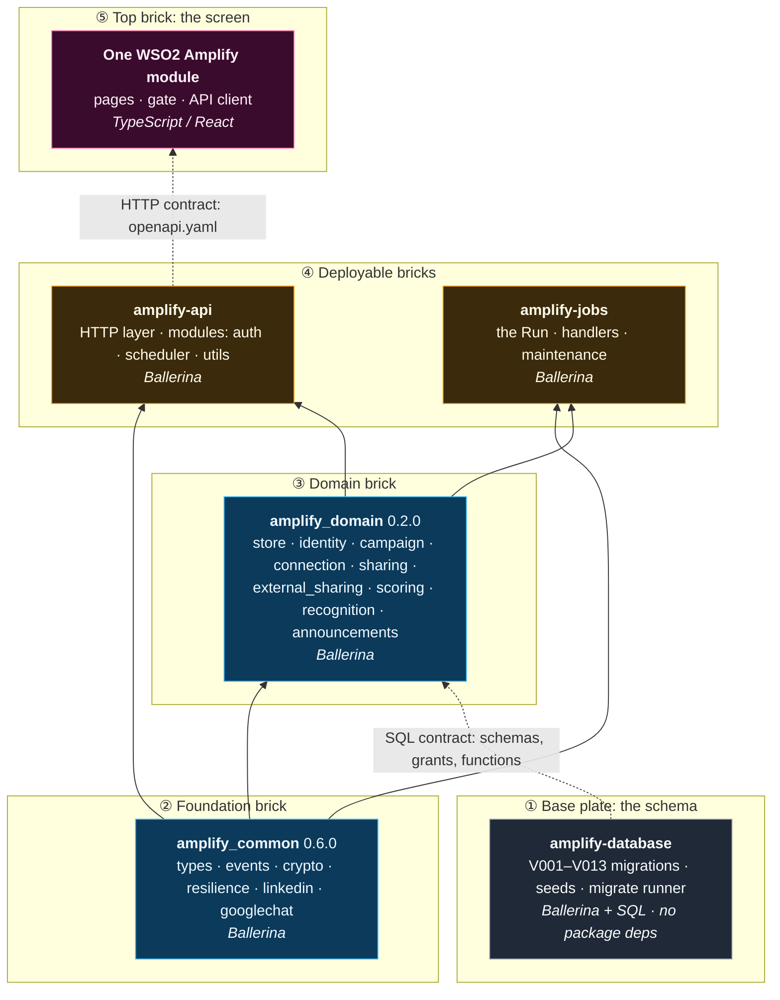
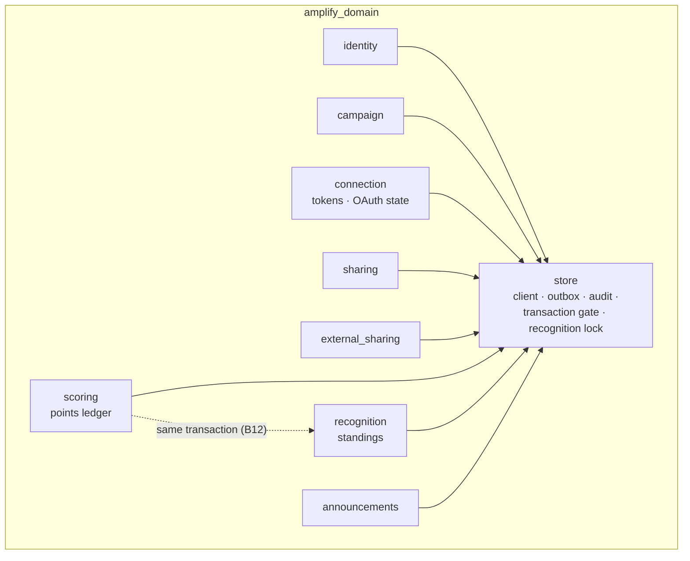
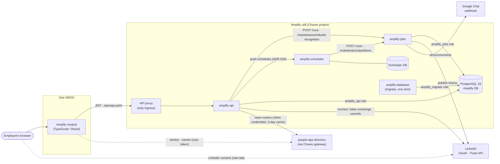

# Phase 1 code modules

How the Amplify phase 1 code fits together, brick by brick. Each module is one piece with a single job. The pieces stack at build time, where one package depends on another, and snap together at run time, where one component calls another. Everything here is as built on `feat/phase1-build` (2026-10-18), updated 2026-10-19: the backend lives in marketing-tools at `apps/amplify` (ADR-033), team rosters come from people-app's directory (ADR-019), and the phase 1 UI follows the 2026-10-19 phase breakdown.

Related: [phase1-solution-architecture.md](phase1-solution-architecture.md) (logical view) · [phase1-data-model.md](phase1-data-model.md) · [activity-matrix.md](activity-matrix.md) · ADR-020, ADR-021, ADR-026, ADR-027 and ADR-032 in [architecture/decisions](../../decisions/README.md).

## The bricks

| Module | What it is | Language | Unit tests | Integration tests | Total | Pass % |
|---|---|---|---|---|---|---|
| `amplify-api` | Published API behind the Choreo proxy | Ballerina | 84 | — | **84** | 100% |
| `amplify-common` | Shared lib: types, crypto, resilience, LinkedIn/Chat adapters | Ballerina | 155 | — | **155** | 100% |
| `amplify-domain` | Shared lib: bounded contexts, Postgres repositories, store | Ballerina | 95 | 28 | **123** | 100% |
| `amplify-jobs` | HTTP-triggered worker (the Run, maintenance) | Ballerina | 54 | 5 | **59** | 100% |
| `amplify-database` | Migrate runner plus 13 migrations (V001–V013) and seeds | Ballerina + SQL | 22 | 16 | **38** | 100% |
| `amplify-scheduler` | Pinned akornatskyy/scheduler image plus history-retention SQL | Dockerfile + SQL (upstream image is Go) | — | 2 | **2** | 100% |
| `chat-stub` (local) | Google Chat webhook stub for Compose | Ballerina | 2 | — | **2** | 100% |
| `people-stub` (local) | people-app directory stub for Compose (`GET /employees/basic-info`) | Ballerina | 2 | — | **2** | 100% |
| people-app prototype (`local/people-app-proto`) | Real people-app behind a gateway stand-in; amplify-api reads it as a service client | Bash + Node + Ballerina | — | 11 checks | **11** | 100% |
| people-app service clients (`projects/people-ops-suite`, PR) | Lets a listed service client read `GET /employees/basic-info` | Ballerina (2201.12.7) | 5 | — | **5** | 100% |
| `mock_linkedin` (`projects/marketing-tools/apps/amplify/linkedin`) | LinkedIn OAuth + Posts mock | Ballerina | 30 | — | **30** | 100% |
| e2e (`scripts/e2e-local.sh`) | Whole local stack: register → share → points → leaderboard | Bash + curl | — | 6 checks | **6** | 100% |
| One WSO2 Amplify UI, phase 1 (`feat/amplify-people-data`, PR) | Celebrate, New Post, Current Posts, LinkedIn link, photos and names | TypeScript / React | 13 | — | **13** | 100% |

Counts from 2026-10-19: `TIERS="unit it scheduler" scripts/test-all.sh` (465 passing), `bal test` in `mock_linkedin` (30), the e2e and prototype checks, people-app's service-client tests and the Amplify vitest files in One WSO2 (13). Nothing fails in Amplify code. The full One WSO2 suite has 3 failures outside Amplify (the perspective colour cap and two InfraHomePage tests) that also fail on untouched upstream `main`.

**Two One WSO2 Amplify UIs exist.** `feat/amplify-module` (46 files, 12 test files, 194 tests, worktree `amplify-wt/m7-ui`, not merged) is the earlier M7 build of the older screen set: Posts, Leaderboard, My Campaign, Team, PO (review, point rules, dashboard), Admin, Reports, Connections. `feat/amplify-people-data` is the phase 1 build from the Phase 1 UX PDF. Under the 2026-10-19 phase breakdown, most of `feat/amplify-module`'s extra screens are phase 2 or 3 work; which pieces to carry forward from it is still open. `amplify-scheduler` has no code of its own; its two tests are shell scripts that drive the image. Paths are under `projects/marketing-tools/apps/amplify/` unless noted. The UI lives in the `projects/one-wso2` submodule.

## How the bricks stack (build time)

Each brick may only depend on the bricks below it. The two shared libraries are versioned Ballerina packages (`amplify_common` 0.6.0, `amplify_domain` 0.2.0, distribution 2201.13.3). Locally they're published to the local Ballerina repository. Each Dockerfile packs them inside its own build stage, so a clean checkout builds (ADR-020, ADR-021, ADR-027).

A solid arrow is a package dependency (`[[dependency]]` in `Ballerina.toml`). A dotted arrow is a contract with no code link: the domain's SQL assumes the tables, grants and functions the migrations create, and the UI builds against `openapi.yaml`.

| Brick | Depends on | Owns | Never does |
|---|---|---|---|
| `amplify-database` | nothing | Schemas, roles and column grants, partition functions, views, seeds; forward-only `V###__*.sql` | Run at request time. It's a one-shot Manual Task / Compose job |
| `amplify_common` | stdlib only | Value objects, ledger references (ADR-029), event shapes, AES-256-GCM token cipher, breakers and retry, LinkedIn adapter and ID-token validator, Google Chat card builder and client | Touch the database |
| `amplify_domain` | `amplify_common` | One module per bounded context: domain rules, repository ports, Postgres repositories. `store` holds the client, outbox and audit writers, and the process-wide transaction gate (ADR-032) | Speak HTTP |
| `amplify-api` | common + domain | Resources, JWT verification and activity matrix (`modules/auth`), idempotency, problem details, scheduler sync (`modules/scheduler`) | Post to LinkedIn or Chat; that's the jobs' work |
| `amplify-jobs` | common + domain | The Run (outbox drain → LinkedIn shares, Chat announcements, scoring), partition upkeep, token key rotation, recognition rebuild | Run on its own timer (ADR-003); the scheduler triggers it |
| One WSO2 module | `openapi.yaml` (contract) | Rail, role gate (`GET /me`), screens, idempotency keys, LinkedIn consent popup | Hold roles of its own; the backend's `/me` and `actions` decide |

### The domain brick, opened up

Each bounded context is its own module with its own schema (ADR-005). Contexts don't call each other's repositories. The one deliberate exception is the ledger append, which updates `recognition` in the same transaction (B12).

## How the bricks snap together (run time)

At run time the pieces connect over HTTP and SQL inside one Choreo project, which is one cell. The API proxy is the only way in. Calls out of the cell go only through declared connections.

| Connection | From → to | Carries | Guard |
|---|---|---|---|
| Ingress | UI → proxy → api | Every user request, JWT from Asgardeo | Gateway JWT plus the api's own verifier (ADR-022), activity matrix |
| Trigger a run | api → jobs | "Save & Share Now", leaderboard rebuild | Project visibility only; jobs is never published |
| Schedules | api → scheduler | Run and maintenance schedules from admin settings | Scheduler is internal only (no auth upstream); reconcile overwrites drift |
| Timer | scheduler → jobs | `POST /runs` (300 s deadline), `POST /maintenance/partitions` | Jobs' run lock: one run at a time |
| Data | api, jobs, migrate → Postgres | SQL, one DB role per component | Column-level grants, `VERIFY_FULL` TLS by default, transaction gate (ADR-032) |
| LinkedIn | api → LinkedIn (connect); jobs → LinkedIn (post) | OAuth code exchange, userinfo, `/rest/posts` | Breakers, per-run and per-day ceilings, tokens encrypted at rest |
| Chat | jobs → Google Chat | Campaign announcement cards | Webhook URL is a secret; plain HTTP only to an exact loopback host |
| Roster | api → people-app (`GET /employees/basic-info`) | Team membership for My Team (sub-team, else team) | OAuth2 client credentials; people-app allows the client on that route only; breaker; index cached 3 days; `teamStatus` degrades instead of failing |
| Photos and names | UI → people-app | Leaderboard photos and full names | The user's own token; falls back to amplify-api's name and initials |

## Swapping bricks: local stand-ins

Locally, Compose swaps the outside bricks for stand-ins with the same interface, so the cell runs on a laptop. Mock vs real is configuration only (README, "LinkedIn: mock or real").

| Real brick | Local stand-in | Used by |
|---|---|---|
| LinkedIn | `mock_linkedin` (`projects/marketing-tools/apps/amplify/linkedin/apps/mock_linkedin`) | Compose, jobs integration tests, e2e |
| Google Chat | `chat-stub` (`local/chat-stub`) | Compose; jobs tests use an in-test stub |
| Asgardeo + API proxy | dev-only signed JWT (`local/dev-jwt`, ADR-023, `ENVIRONMENT=local` only) | Compose, e2e |
| Managed Postgres | `postgres:18` container | Compose, integration tests |
| people-app directory | `people-stub` (`local/people-stub`, edit `directory.json`); or the real people-app via `local/people-app-proto` | Compose; a local One WSO2 for photos |
| Choreo API proxy in front of One WSO2's calls | dev proxy (`local/one-wso2-proxy`): swaps a ThunderID or Asgardeo token for a dev JWT | A local One WSO2 against the Compose stack |

Which tests reach which LinkedIn stand-in:

| Tests | LinkedIn double |
|---|---|
| amplify-api unit | in-process `FakeLinkedIn` (`amplify-api/tests/read_fakes.bal`) |
| amplify-jobs unit | in-process `FakeLinkedIn` (`amplify-jobs/tests/fakes.bal`) |
| amplify-common unit | its own HTTP stub on 18210, to check the exact wire format |
| amplify-domain | no LinkedIn calls |
| amplify-jobs integration (`integration`, `db-down-it`) | real `mock_linkedin` on 19190/19191, started by `test-all.sh` |
| e2e | real `mock_linkedin` in Compose |

## Rules that keep the bricks fitting

- **Build order:** `amplify_common`, then `amplify_domain`, then api and jobs. Bump the version when a shared lib's public API changes, and update the `[[dependency]]` in each consumer.
- **Each brick owns its seams:** a new api route needs `openapi.yaml` (`x-roles`), a matrix row and the resource. `tests/contract_test.bal` and `tests/contract_drift_test.bal` fail otherwise.
- **Schema changes are new migrations only** (`V014__…`), with a dated note in `docs/migrations/`.
- **Every `transaction {}` block goes through `store:inTransaction`** until the Ballerina 2201.14 upgrade (R-13, ADR-032). `make check` enforces it.
- **`make check`** also keeps the Choreo descriptors, `workload.yaml`, Dockerfiles and Compose in sync, and scans log calls for PII.
