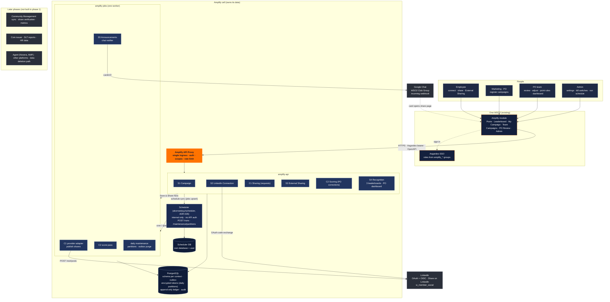

# WSO2 Amplify: Phase 1 Solution Architecture

Logical view (audit D1): contexts, cell edge, deployables and externals. No Choreo specifics; see [phase1-domains.md](phase1-domains.md) for the contexts and [phase1-planned-todos.md](../../../docs/requirements/phase1-planned-todos.md#architecture-at-a-glance) for the deployment view. For how the code modules stack and connect, see [phase1-code-modules.md](phase1-code-modules.md).

