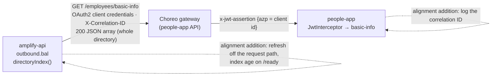

# Integration boundary review: amplify-api → people-app directory

Date: 2026-10-19 · Method: WSO2 Digital integration-boundary checklist (8 items) · Scope: `amplify-api` reading people-app `GET /employees/basic-info` for team rosters (ADR-019), and people-app's service-client admission (people-ops-suite PR).

## Checklist

| # | Item | Verdict | Severity | Evidence / gap |
|---|---|---|---|---|
| 1 | Authentication | **Pass** (with an inherited caveat) | — | OAuth2 client credentials through a Choreo connection (`peopleDirectoryTokenUrl/ClientId/ClientSecret`); people-app admits only listed client ids, only on this route (403 elsewhere). Documented in ADR-019, threat model B-E3, choreo-deploy C7. Caveat: people-app decodes the gateway assertion without verifying its signature (threat model AMP-R9, inherited). The client-id claim (`azp`) is unconfirmed on a real token (AMP-R5). |
| 2 | Correlation ID | **Gap** (receiver) | Medium | amplify-api sends `X-Correlation-ID` (`outbound.bal` `fetchDirectory`). people-app never reads or logs it (no correlation handling anywhere in people-app), so a failed directory call can't be joined to people-app's log. The gateway's own logs are the only bridge. Not High: the caller does generate and send it. |
| 3 | Idempotency | **N/A** | — | Read-only `GET`; nothing is written on either side. |
| 4 | Resolved identifiers | **Gap** | Medium | The join key is the work email (`workEmail` ↔ Amplify `identity.employee.email`). Amplify's employee id is the IdP `sub`; people-app's is `employeeId`; neither side carries the other. An email change, alias or casing difference (handled) drops a person from their team (`NO_TEAM`) until both sides agree. Not High: no system of record is written. |
| 5 | Persist-first async | **Gap** (adapted: read on the request path) | Medium | No ingest here, but the rule's spirit (no synchronous downstream call in the user's request path) is broken once every 3 days: `rosterStatus` runs inside `/leaderboard`, `/team` and `/team/{id}/history`, and the first request after the index expires waits for the whole-directory fetch (timeout 10 s). |
| 6 | Single writer via Entity Service | **N/A** | — | No writes. |
| 7 | Feedback loop | **Partial** | Low | Breaker state is on `/ready` (`roster`); refresh failures are logged (`People directory refresh failed; using the cached teams`) and the old index keeps serving. Missing: the index's age and size, so "teams stopped updating" is visible without reading logs. |
| 8 | Gateway + quota | **Partial** | Low | Crosses the Choreo gateway; load is tiny (one call per replica per 3 days, plus restarts). No single-flight: concurrent requests on a cold or expired index each fetch the directory (the lock is released before the call), so a restart under load sends a burst of whole-directory reads. No explicit rate limit or quota agreed with people-app. |

**Overall:** no High findings. The boundary is authenticated and narrow; the gaps are operational.

## The single fix that closes the most items

**Refresh the directory index off the request path, one fetch at a time.** Build it at start-up and refresh it on a timer (or through the scheduler, like the other maintenance jobs), behind a single-flight guard, and report its age and size on `/ready`. Requests then only ever read the in-memory index. That closes 5, closes the burst in 8 and the visibility gap in 7, and puts every directory call under one correlation ID per refresh that's easy to find (2, caller side).

## Other follow-ups

- **people-app:** read `X-Correlation-ID` in the interceptor and include it in its log lines (item 2). Small, and useful beyond Amplify.
- **Join key (item 4):** decide whether people-app's `employeeId` or the IdP subject can travel on the directory rows, or accept email as the key and document what happens when it changes (operations runbook §13 already covers diagnosing `NO_TEAM`).
- **Quota (item 8):** agree with the people-app team on the expected call rate (documented: one per replica per 3 days) and whether the gateway should rate-limit this client.
