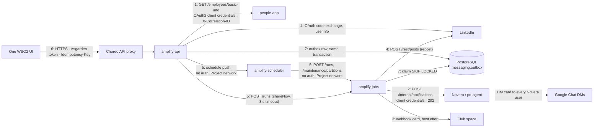

# Integration boundary review: every Amplify system-to-system boundary

Date: 2026-10-26 · Method: WSO2 Digital integration-boundary checklist (8 items), applied to each boundary · Replaces the scope of the 2026-10-19 review, which covered one boundary (amplify-api reading the people-app directory). The surface has grown since: house and BU boards, headcount, Novera, dashboards, CSV export, the scheduler.

Code was read, not run. No Docker, no tests, no live calls. What I could not confirm is listed at the end.

## Boundaries in scope

## Verdict per boundary

| # | Boundary | Verdict | Medium | Low | Main reason |
|---|---|---|---|---|---|
| 1 | amplify-api → people-app directory | Works, gaps unchanged | 3 | 5 | Nothing from the 19 Oct review was fixed. The request-path dependency grew (house, BU, headcount boards). |
| 2 | amplify-jobs → Novera / po-agent | Needs work before go-live | 4 | 3 | No dedupe key, no delivery feedback, no correlation id on the receiver, no deploy or threat-model coverage. |
| 3 | amplify-jobs → Google Chat webhook | Pass | 0 | 1 | Duplicate-on-lost-write risk accepted in ADR-025. |
| 4 | amplify-api / jobs → LinkedIn | Pass with caveats | 0 | 2 | ID-token check off by default, correlation id missing on OAuth calls, `/rest/posts` limits not read yet. |
| 5 | api ↔ scheduler ↔ jobs | Pass with an accepted risk | 1 | 1 | No auth by design (ADR-026). Trigger timeout does not match a synchronous run. |
| 6 | One WSO2 UI → amplify-api | Pass | 1 | 3 | CSV export silently stops at 200,000 rows. |
| 7 | Outbox inside the database | Pass on the mechanics, gap on visibility | 1 | 0 | Deferred rows never fail, so nothing alerts on a stuck queue. |

No High findings. By the skill's rule, missing auth is High, so finding N7 (no auth on the scheduler and jobs endpoints) is rated Medium only because ADR-026 accepts it and the network isolation is documented. That sign-off needs to be recorded.

## Findings by severity

IDs starting with C carry forward the 19 Oct checklist item of the same number. N is new in this review.

| ID | Severity | Boundary | Finding | Status |
|---|---|---|---|---|
| C2 | Medium | 1 | people-app never reads or logs `X-Correlation-ID` | Still open |
| C4 | Medium | 1, 6 | Join key is the work email; people-app `employeeId` and the IdP `sub` never meet | Still open |
| C5 | Medium | 1 | Directory fetch runs on the request path. Now also on group boards and headcount, and the dashboards read the count | Still open, wider |
| N1 | Medium | 2 | Novera has no idempotency key. A failed save after a 202 sends the card to every DM again | New |
| N2 | Medium | 2 | Amplify marks the announcement `SENT` on 202. Delivery counts stay in po-agent logs | New |
| N3 | Medium | 2 | po-agent never reads `X-Correlation-ID` | New |
| N4 | Medium | 2 | Novera is missing from the egress allow-list, the deploy runbook, the threat model and the ADRs | New |
| N5 | Medium | 7 | Deferred outbox rows never reach `FAILED`, and no metric shows queue depth or oldest pending age | New |
| N6 | Medium | 6 | `GET /dashboards/export` cuts at 200,000 rows with no marker | New |
| N7 | Medium (accepted) | 5 | Scheduler API, `POST /runs` and `/maintenance/*` have no authentication | New, accepted in ADR-026 |
| C1 | Low | 1 | Inherited: people-app decodes the gateway assertion without verifying the signature (AMP-R9). Two claims unconfirmed on a real token (AMP-R5) | Still open |
| C7 | Low | 1 | `/ready` has no directory index age or size | Still open |
| C8 | Low | 1 | No single-flight on the directory fetch, no agreed quota | Still open |
| N8 | Low | 5 | The shareNow trigger times out at 3 s against a run that can take 240 s | New |
| N9 | Low | 2 | Amplify allows image URLs up to 2048 characters, Novera accepts 2000 | New |
| N10 | Low | 2 | `longestCallSeconds` ignores the Novera path | New |
| N11 | Low | 2 | Any app subscribed to Novera can send a card under any `source` | New |
| N12 | Low | 4 | OAuth token exchange and userinfo carry no correlation id. ID-token validation is off by default | New |
| N13 | Low | 3, 4 | A lost write after a LinkedIn or Chat success can post twice (ADR-025 item 5) | Accepted |
| N14 | Low | 6 | The UI neither sends nor shows a correlation id | New |
| N15 | Low | 6 | UI wire types are hand-written, no check against `openapi.yaml` on the UI side | New |
| N16 | Low | 1 | people-app sends every directory column. Amplify reads five | New |
| N17 | Low | 1 | One request can fetch the directory twice | New |
| N18 | Low | all | Documents and config comments that no longer match the code | New |
| N19 | Low | 6 | The CSV export (names, emails) writes no audit entry | New |

## Carried forward from 19 October

| 19 Oct item | Then | Status now | Evidence |
|---|---|---|---|
| 1 Authentication | Pass, with an inherited caveat | **Still open** (caveat only). The boundary still passes. The caveat widened: people-app now also needs the `aut` claim to match `APPLICATION`, so two claims are unconfirmed on a real Choreo token, not one. The unsigned-assertion risk is unchanged. | [allowedServiceClient, jwt:decode](../../../../../people-ops-suite/apps/people-app/backend/modules/authorization/authorization.bal#L42), [claim defaults](../../../../../people-ops-suite/apps/people-app/backend/modules/authorization/types.bal), threat model AMP-R5 and AMP-R9, [choreo-deploy C7 step 2](../runbooks/choreo-deploy.md) |
| 2 Correlation ID (receiver), Medium | Gap | **Still open.** amplify-api sends it. people-app has no correlation handling anywhere in its backend. | [fetchDirectory](../../amplify-api/outbound.bal#L435), [people-app interceptor](../../../../../people-ops-suite/apps/people-app/backend/modules/authorization/authorization.bal) |
| 3 Idempotency | N/A | **Unchanged.** Read-only GET. | [basic-info handler](../../../../../people-ops-suite/apps/people-app/backend/service.bal#L750) |
| 4 Resolved identifiers, Medium | Gap | **Still open.** Email is still the key. The new house and BU maps use the same key and take names as text. | [indexDirectory](../../amplify-api/outbound.bal#L333) |
| 5 Persist-first async, Medium | Gap | **Still open, wider.** `directoryIndex` and `headcountSnapshot` still fetch inline, with a 10 s timeout. Callers grew from three roster reads to also include group boards, headcount and the dashboards (which degrade without the count instead of failing). | [directoryIndex](../../amplify-api/outbound.bal#L408), [headcountSnapshot](../../amplify-api/outbound.bal#L529), [rosterStatus](../../amplify-api/reads.bal#L151), [groups.bal](../../amplify-api/groups.bal#L219), [dashboards.bal](../../amplify-api/dashboards.bal#L85) |
| 6 Single writer | N/A | **Unchanged.** No writes. | same |
| 7 Feedback loop, Low | Partial | **Still open.** `/ready` still reports the `roster` breaker only. No index age or size. | [breakerStates](../../amplify-api/outbound.bal#L223), [ready](../../amplify-api/service.bal#L101) |
| 8 Gateway and quota, Low | Partial | **Still open.** No single-flight (the lock is released before the call). **Superseded in part:** "one call per replica per 3 days" is no longer the whole story. The employee count has its own 7-day clock and fetches the directory too. | [outbound.bal](../../amplify-api/outbound.bal#L408), [ADR-035 item 5](../../architecture/decisions/ADR-035-open-leaderboards-and-employee-count.md) |
| Single fix: refresh the index off the request path, one fetch at a time, report age on `/ready` | Recommended | **Still open.** Not started. Now covers the headcount snapshot too. | same as item 5 |
| Follow-up: people-app reads `X-Correlation-ID` | Recommended | **Still open.** | see item 2 |
| Follow-up: decide the join key | Recommended | **Still open.** [Operations §13](../runbooks/operations.md) still says to compare the two emails by hand. | see item 4 |
| Follow-up: agree a quota with the people-app team | Recommended | **Still open.** No agreed rate in any runbook. | [rate-limiting.md](../runbooks/rate-limiting.md) lists no people-app row |
| ADR-019 visibility rules | Context | **Superseded** for ranks and points by ADR-035. The Team page, history and roster source still follow ADR-019. | [ADR-019](../../architecture/decisions/ADR-019-leaderboard-team-visibility.md), [ADR-035](../../architecture/decisions/ADR-035-open-leaderboards-and-employee-count.md) |

Nothing from the 19 Oct review is Fixed.

## Boundary 1: amplify-api → people-app directory

Code: [outbound.bal](../../amplify-api/outbound.bal), [people-app authorization](../../../../../people-ops-suite/apps/people-app/backend/modules/authorization/authorization.bal), [basic-info handler](../../../../../people-ops-suite/apps/people-app/backend/service.bal#L750), [directory query](../../../../../people-ops-suite/apps/people-app/backend/modules/database/db_queries.bal#L52).

What changed since 19 Oct: the directory row now carries `house`, the index builds BU and house membership, `GET /headcount` and the group boards read it, and people-app admits a service client on exactly one route. The route check compares two path segments exactly, so an encoded slash is refused, and a test covers POST, other client ids and a blank client id.

| # | Item | Verdict | Severity | Evidence and gap |
|---|---|---|---|---|
| 1 | Authentication | Pass, caveat | Low (C1) | Client credentials through a Choreo connection. people-app admits a listed client id, only when `aut = APPLICATION`, only for `GET employees/basic-info`. The assertion is decoded, not verified (AMP-R9). `azp` and `aut` are unconfirmed on a real token. |
| 2 | Correlation ID | Gap (receiver) | Medium (C2) | Sent on every call. Not read or logged by people-app. |
| 3 | Idempotency | N/A | none | Read-only. |
| 4 | Resolved identifiers | Gap | Medium (C4) | Work email is the join key. House and BU are text names. |
| 5 | Persist-first async | Gap, adapted | Medium (C5) | Whole-directory fetch with a 10 s timeout inside user requests when a cache expires. |
| 6 | Single writer | N/A | none | No writes. |
| 7 | Feedback loop | Partial | Low (C7) | Breaker on `/ready`, refresh failure logged, old index kept. No age or size. |
| 8 | Gateway and quota | Partial | Low (C8) | Crosses the Choreo gateway. No single-flight, no agreed rate. |

New in this boundary:

- **N16 (Low).** people-app returns every directory column, including manager email, start date, job band and work location. Amplify reads `workEmail`, `team`, `subTeam`, `businessUnit` and `house`, and the comment in the authorization module says the data is what every signed-in employee already reads. Amplify drops the rest and never stores it. A narrower route or a `fields` parameter would cut what crosses the wire.
- **N17 (Low).** The group boards call `directoryIndex` and then `headcountSnapshot`. When both caches expire in the same window, one request fetches the whole directory twice ([groups.bal](../../amplify-api/groups.bal#L219)). The fix is one fetch that fills both caches.
- **Circuit breaker.** `requestVolumeThreshold: 1` with a 0.5 failure threshold means one 5xx opens the breaker for 30 s ([newBreakerClient](../../amplify-api/outbound.bal#L97)). Stale data keeps serving, so the cost is small. On a cold start it means a 30 s `UNAVAILABLE`.

The single fix is unchanged and now closes more: **build the index and the count at start-up, refresh on a timer behind a single-flight guard, report age and size on `/ready`.** Requests only read memory. That closes C5, N17 and the burst in C8, and gives C7 its numbers.

## Boundary 2: amplify-jobs → Novera / po-agent

Code: [novera.bal](../../amplify-jobs/novera.bal), [handleCampaignRegistered](../../amplify-jobs/handlers.bal#L124), [buildNoveraNotification](../../amplify-domain/modules/announcements/service.bal#L148), [po-agent route](../../../../../wso2-digital-agents/po-agent/src/index.ts#L402), [notify.ts](../../../../../wso2-digital-agents/po-agent/src/chat/notify.ts#L216).

Flow: the `CampaignRegistered` outbox row makes jobs build a notification (title, summary, image, an Amplify button that opens Celebrate with `?share=<campaignId>`). Jobs posts it to Novera through the Choreo gateway with a client-credentials token. po-agent validates, checks Google Chat access, answers 202, then sends one card per DM, 10 at a time, about 20 a second, with its own retries. When Novera is on, the Club webhook becomes best effort.

What the team got right: the HTTP client is built on first use, so a down token endpoint cannot stop jobs from starting. A 503 from Novera (no Google token, nothing sent) is retryable. A 4xx is not. HTTPS is enforced unless a local flag is set. The outbox retries with backoff, the announcement row records the outcome, and an admin retry exists.

| # | Item | Verdict | Severity | Evidence and gap |
|---|---|---|---|---|
| 1 | Authentication | Pass, caveat | Low (N11) | Client-credentials token from an application subscribed to Novera's API. po-agent has no check of its own and relies on the gateway, and its comment says this was verified live. `source` is a free field, so any subscribed app can send under any name. |
| 2 | Correlation ID | Gap (receiver) | Medium (N3) | Jobs sends `X-Correlation-ID`. po-agent has no correlation handling. Its log lines carry `source` and counts only. |
| 3 | Idempotency | Gap | Medium (N1) | No key in the request. See below. |
| 4 | Resolved identifiers | N/A | none | A broadcast. The campaign id travels in the button URL. |
| 5 | Persist-first async | Pass | none | The outbox row is the persisted work. Novera answers 202 before sending. |
| 6 | Single writer | N/A | none | Novera owns its DM table and the card. |
| 7 | Feedback loop | Gap | Medium (N2) | `SENT` is set on 202. Sent, failed, retried and removed counts are `console.log` lines in po-agent. Zero DMs or all failed still reads `SENT` in Amplify. |
| 8 | Gateway and quota | Partial | Medium (N4) | Goes through the Choreo gateway. po-agent paces sends to stay under Google's 3,000 writes a minute. The egress allow-list in the deploy runbook names no Novera host. |

**N1, the rebroadcast window.** Jobs calls Novera, gets 202, then saves the announcement as sent. If that save fails, or the lease expires first, the row goes back to the queue. The announcement is still `QUEUED`, so the next attempt calls Novera again. Every employee with a DM gets a second card, and the webhook posts a second Club card with it. [ADR-025 item 5](../../architecture/decisions/ADR-025-jobs-run-delivery-and-resilience.md) accepts this window for LinkedIn and the webhook. It predates Novera, so the cost it priced in (one extra post) is not the cost here (every DM). The window is small, but a hit reaches the whole company. The fix lives in Novera: accept an optional `idempotencyKey` (jobs would send `amplify:<campaignId>`) and refuse a repeat inside a day.

**N2, no delivery feedback.** po-agent knows the DM count before it answers. Returning `{accepted: true, recipients: n}` in the 202 would let Amplify store the count on the announcement row and show a zero. A status callback or a read endpoint would close the rest.

**N4, deploy and governance gaps.** Searching the runbooks, ADRs and security documents for Novera finds one line, in the threat model's out-of-scope list ("the Amplify agent (Novera)"). The code ships Novera egress, six config keys and a descriptor entry. Missing: an ADR for the primary announcement channel, a threat-model interaction for jobs → Novera, the egress allow-list entry ([choreo-deploy D5](../runbooks/choreo-deploy.md)), config steps in the deploy runbook, a failure row in [resilience-targets](../runbooks/resilience-targets.md), and a rate-limit row for the DM broadcast in [rate-limiting](../runbooks/rate-limiting.md). If the org uses egress control, jobs cannot reach Novera on day one.

Smaller items:

- **N9 (Low).** `imageUrl` may be 2048 characters in Amplify and in the campaign contract. po-agent refuses anything over 2000 with a 400. Jobs treats a 400 as `REJECTED`, not retryable, so that campaign's announcement ends `FAILED`. Cap the image URL at 2000 when building the notification, or fall back to the default image.
- **N10 (Low).** `longestCallSeconds` takes the larger of the LinkedIn timeout and the Chat timeout plus throttle (11 s). A Novera row can spend a token call (10 s), the notify call (10 s) and a Club card (11 s). That is 31 s. With the defaults, 240 s plus 31 s still fits inside the 300 s lease, so nothing breaks today. The startup guard would not catch a tuning change that does.
- **N18 (Low, this boundary).** The comments on `amplifyOnNovera` and `amplifyOnWebhook` in [config.bal](../../amplify-jobs/config.bal#L77) still say "Not acted on yet". The handler acts on both.

Fix that closes the most here: **add an idempotency key to Novera's contract, return the recipient count in the 202, and read and log `X-Correlation-ID` in po-agent.** That closes N1, N2 and N3 with one small change on the receiver and one extra field on the sender.

## Boundary 3: amplify-jobs → Google Chat webhook

Code: [googlechat client](../../amplify-common/modules/googlechat/client.bal), [WebhookChat](../../amplify-jobs/ports.bal#L260), [runbook](../runbooks/google-chat-webhook.md).

| # | Item | Verdict | Severity | Evidence and gap |
|---|---|---|---|---|
| 1 | Authentication | Pass | none | The webhook URL carries the key and token. It is a Choreo secret, HTTPS only (loopback or a local flag excepted), never logged and never in an error. Rotation steps are in the runbook. |
| 2 | Correlation ID | Pass | none | Sent on the call. Google cannot carry it. The outbox row and run log hold it. |
| 3 | Idempotency | Gap, accepted | Low (N13) | No HTTP retry by design. Retry goes through the outbox. A lost write can post twice. The thread key per campaign keeps a duplicate in the same thread. `messages.create` has a `requestId` parameter, and I could not confirm that webhooks honor it (see the end). |
| 4 | Resolved identifiers | N/A | none | |
| 5 | Persist-first async | Pass | none | Outbox, then post. |
| 6 | Single writer | N/A | none | |
| 7 | Feedback loop | Pass | none | The announcement row records message name, thread, `sent_at` or `failed_at`. Admin retry re-queues it. |
| 8 | Gateway and quota | Pass | none | One request a second per space is enforced in `WebhookChat`. Own pool and breaker. Quota is in the rate-limiting runbook. |

With Novera on, this boundary is best effort. A failure is logged and not retried, so a retry never doubles the Club card ([handlers.bal](../../amplify-jobs/handlers.bal#L182)). I agree with that choice.

## Boundary 4: amplify-api and amplify-jobs → LinkedIn

Code: [adapter.bal](../../amplify-common/modules/linkedin/adapter.bal), [id_token.bal](../../amplify-common/modules/linkedin/id_token.bal), [connect handlers](../../amplify-api/handlers.bal#L178), [handleRepostRequested](../../amplify-jobs/handlers.bal#L232), [ADR-034](../../architecture/decisions/ADR-034-share-is-a-repost.md). The external-sharing context makes no LinkedIn call. It records evidence URLs an employee submits, and ADR-018 says verification needs a scope Amplify does not have.

| # | Item | Verdict | Severity | Evidence and gap |
|---|---|---|---|---|
| 1 | Authentication | Pass, caveat | Low (N12) | Three-legged OAuth. State is issued per employee and consumed once, the redirect URI is checked, tokens are sealed with a key ring, and the userinfo `sub` becomes the member URN. ID-token validation (signature, issuer, audience, `sub` match) exists and is **off by default** until a real app is seen returning the token. No nonce, no PKCE (the code comments explain both). |
| 2 | Correlation ID | Partial | Low (N12) | Sent on `POST /rest/posts`. Not sent on the token exchange or userinfo ([adapter.bal](../../amplify-common/modules/linkedin/adapter.bal#L100)). |
| 3 | Idempotency | Gap, accepted | Low (N13) | No key on the post. Guards: share re-read before the call, one share per employee per campaign, unique engagement key, `recordDuplicatePublish`. Residual window in ADR-025 item 5: LinkedIn accepted, the database write failed, the retry posts again. |
| 4 | Resolved identifiers | Pass | none | Member URN stored on the connection. A second employee linking the same member gets `MEMBER_ALREADY_LINKED`. The campaign target must be a `share` or `ugcPost` URN. The `activity` form is refused by LinkedIn, and the plan tracks conversion (ADR-034 addendum). |
| 5 | Persist-first async | Pass | none | `POST /campaigns/{id}/shares` queues and returns. Only jobs calls `publishShare`. |
| 6 | Single writer | Pass | none | One poster (jobs). amplify-api never posts. |
| 7 | Feedback loop | Partial | Low | Failures end as `FAILED` with a reason code that the UI maps. A 401 revokes the connection. `RepostFailed` has no subscriber, so no one is told outside the UI. Phase 1 accepts this ([handlers.bal](../../amplify-jobs/handlers.bal#L117)). |
| 8 | Gateway and quota | Partial | Low | Direct egress, covered by the org allow-list step. Per-run (50) and per-day (1,000) ceilings. LinkedIn's limit for `/rest/posts` is still "open (L1)" in the rate-limiting runbook. No per-member counter. |

## Boundary 5: amplify-api ↔ amplify-scheduler ↔ amplify-jobs

Code: [scheduler_sync.bal](../../amplify-api/scheduler_sync.bal), [scheduler client](../../amplify-api/modules/scheduler/client.bal), [jobs service](../../amplify-jobs/service.bal), [run.bal](../../amplify-jobs/run.bal), [ADR-026](../../architecture/decisions/ADR-026-akornatskyy-scheduler.md), [ADR-025](../../architecture/decisions/ADR-025-jobs-run-delivery-and-resilience.md).

The team built the mechanics with care. Jobs are upserted by stable id, the sync is serialized in-process and reads fresh settings inside the lock, an unreachable scheduler leaves the save intact and reports `PENDING`, startup reconciles with retries, and `POST /admin/scheduler/sync` converges on demand. The scheduler's deadline (300 s) is longer than jobs' run budget (240 s). A second `POST /runs` answers 202 `SKIPPED`, which counts as success. One run at a time holds across replicas through a session advisory lock.

| # | Item | Verdict | Severity | Evidence and gap |
|---|---|---|---|---|
| 1 | Authentication | Gap, accepted | Medium (N7) | The scheduler API and UI, `POST /runs`, `/maintenance/partitions` and `/maintenance/rebuild-recognition` have no authentication. Control is network only (Project visibility, no host port). ADR-026 documents this and the threat model covers it. A component in the same project could create a job that calls any URL. The run lock, LinkedIn ceilings and idempotent handlers bound the damage. |
| 2 | Correlation ID | Partial | Low | amplify-api sends it to the scheduler and on the trigger. The scheduler sends static headers, so scheduled runs get none. Jobs falls back to the run id. |
| 3 | Idempotency | Pass | none | Stable job ids. A retried run is safe because outbox handlers are idempotent. |
| 4 | Resolved identifiers | Pass | none | `amplify-run` and `amplify-maintenance-partitions` in collection `amplify`. |
| 5 | Persist-first async | Gap, adapted | Low (N8) | `POST /runs` is synchronous for up to 240 s by design. That forces the 300 s deadline and the 3 s trigger problem below. |
| 6 | Single writer | N/A | none | |
| 7 | Feedback loop | Pass | none | `schedulerSync` status, `SchedulerSynced` audit rows, 30-day scheduler history with a trigger-based purge, run log with counts and breaker states. |
| 8 | Gateway and quota | N/A | none | Internal. Bounded by the run lock, 25-row batches, 200 rows and 240 s per run. |

**N8, the trigger timeout.** `triggerJobs` posts to `/runs` with a 3 s timeout ([outbound.bal](../../amplify-api/outbound.bal#L35)). A run that handles even one LinkedIn post or Novera call takes longer, so the trigger will often time out while the run carries on. The code logs a warning, which is the right call. The open question is the breaker, which uses `requestVolumeThreshold: 1`, so if a timeout counts as a failure, one slow trigger can open the `jobs` breaker for 30 s and later triggers answer `DEFERRED` until the scheduler's next tick (default every 5 minutes). Nothing is lost. "Save & Share Now" gets slower. I did not run it to see how Ballerina counts timeouts. A cheap fix: have jobs answer a trigger with 202 right away and run in the background, or give the trigger client a timeout shorter than the run but exclude it from the breaker's failure count.

## Boundary 6: One WSO2 UI → amplify-api

Code: [useAmplifyMutations.ts](../../../../../one-wso2/webapp/src/features/amplify/api/useAmplifyMutations.ts), [useAmplifyData.ts](../../../../../one-wso2/webapp/src/features/amplify/api/useAmplifyData.ts), [useAmplifyDashboards.ts](../../../../../one-wso2/webapp/src/features/amplify/api/useAmplifyDashboards.ts), [openapi.yaml](../../amplify-api/openapi.yaml), [idempotency.bal](../../amplify-api/idempotency.bal), [dashboards.bal](../../amplify-api/dashboards.bal#L498), [reporting queries](../../amplify-domain/modules/reporting/queries.bal#L486).

Every URL the UI builds exists in the spec. The server checks routes, roles and main response shapes against the spec in `tests/contract_test.bal`. Errors are problem details with stable codes, and the UI maps those codes to sentences and ignores `detail`.

| # | Item | Verdict | Severity | Evidence and gap |
|---|---|---|---|---|
| 1 | Authentication | Pass | none | Asgardeo access token to the Choreo proxy, then backend JWT verification and the activity matrix (ADR-022). A 401 on an unexpired token is treated as the backend's problem and does not raise the session dialog. |
| 2 | Correlation ID | Gap | Low (N14) | The server assigns one when the caller sends none, echoes it on every response and puts it in problem bodies. The UI neither sends nor shows it, so a user cannot quote it to support. |
| 3 | Idempotency | Pass | none | Every POST carries `Idempotency-Key`. The server fingerprints method, route and body per caller, replays the stored response, answers 422 on a reused key with a different body and 409 while the first call runs, and does not store 5xx. The silent re-auth retry reuses the same key. A double click makes a new key, and natural keys stop the duplicate (`CAMPAIGN_ALREADY_REGISTERED`, one share per employee per campaign). PATCH carries a version. The server accepts a POST without the header. Only the UI discipline closes that. |
| 4 | Resolved identifiers | Gap | Low | Photos and names come from the UI reading the people-app directory with the user's own token, joined by email (ADR-009). Same weakness as C4. |
| 5 | Persist-first async | Pass | none | Shares return 202 and wait for a Run. Boards are cached 60 s on the server. |
| 6 | Single writer | N/A | none | |
| 7 | Feedback loop | Pass | none | Stable error codes, mapped copy, retry once on 5xx and never on 4xx. |
| 8 | Gateway and quota | Partial | Low | Everything crosses the proxy. Proxy limits per operation are still "open (P2)" in the rate-limiting runbook, and so is the shape of the 429. |

**N6, silent truncation.** The export query ends with `LIMIT 200000` and the CSV has no marker for a cut ([queries.bal](../../amplify-domain/modules/reporting/queries.bal#L541)). The range allows 366 days and one row per engagement, share attempt, ledger row, campaign and connection. A year with ~800 active employees can plausibly pass 200,000 rows (a count I did not measure). A PO would read a partial file as complete. Return a 413 or a `truncated` row, or page the export. The CSV is also built whole in memory on both sides.

**N19, no export audit.** The file holds names and emails for dashboard roles. Reads are not audited today, and a bulk export is the case where an audit row earns its keep.

**N15.** [amplifyTypes.ts](../../../../../one-wso2/webapp/src/features/amplify/api/amplifyTypes.ts) is typed by hand "from the OpenAPI" and types only the fields the screens read. A server rename would show up at runtime. A generated type or a UI contract test would catch it at build time.

## Boundary 7: outbox inside the database

Code: [outbox.bal](../../amplify-domain/modules/store/outbox.bal), [events.bal](../../amplify-common/modules/events/events.bal#L277), [run.bal](../../amplify-jobs/run.bal), [V008 migration](../../amplify-database/migrations/V008__announcement_messaging_audit_config.sql), [operations §1](../runbooks/operations.md).

| # | Item | Verdict | Severity | Evidence and gap |
|---|---|---|---|---|
| 1 | Authentication | Pass | none | One database user per component. amplify_api and amplify_jobs hold the grants on `messaging.outbox`. I read the outbox grant, not every grant. |
| 2 | Correlation ID | Pass | none | `correlation_id` is written by the producer. Jobs uses it or the run id and passes it to LinkedIn, Chat, Novera and the audit rows. |
| 3 | Idempotency | Pass | none | `UNIQUE (idempotency_key)` with `ON CONFLICT DO NOTHING`. Keys are built from stable ids. Handlers re-read the aggregate before acting. Ledger references and the engagement key are the last line. |
| 4 | Resolved identifiers | Pass | none | Events carry campaign, employee and share-request ids. Handlers re-read current state. |
| 5 | Persist-first async | Pass | none | Written in the aggregate's transaction (through the transaction gate). Claimed `FOR UPDATE SKIP LOCKED` in batches of 25. A run is bounded to 200 rows and 240 s. A 300 s lease releases a dead run's rows and keeps the counted attempt. |
| 6 | Single writer | Pass | none | amplify-api produces, jobs consumes and owns the `announcement` rows. |
| 7 | Feedback loop and DLQ | Partial | Medium (N5) | `FAILED` is the dead-letter state, with `last_error`. Requeue is manual SQL, except an admin retry for announcements. ADR-025 and the runbook say so. Visibility is the gap, below. |
| 8 | Gateway and quota | N/A | none | Internal. |

**N5, the silent queue.** A deferral gives the attempt back and puts the row back with a delay. It happens when a kill switch is off, when no announcement channel is configured, when a campaign has not opened, or when a LinkedIn ceiling is reached. Those rows never reach `FAILED`, so the "outbox `FAILED`" alert never fires. The run log shows a `deferred` count per run, and the alert list in [choreo-deploy](../runbooks/choreo-deploy.md) is log-based. Nothing in the code exports queue depth or the age of the oldest pending row. Picture a deploy with the Novera settings empty: every announcement waits, no alert fires, and the first sign is a PO asking where the card went. Add two gauges from the maintenance or run path (pending count, oldest pending age) and alert on age.

Smaller: `FAILED` rows are never purged, and `DONE` rows are purged at 30 days. I would keep both.

## Documents and comments that no longer match (N18)

| Where | What is stale |
|---|---|
| [ADR-009](../../architecture/decisions/ADR-009-people-data-from-one-wso2.md) | Says the UI enriches rows, the One WSO2 endpoint is "still to be found", and Amplify stores no people data. amplify-api now reads the directory itself (ADR-019, ADR-035) and keeps display name and email in `identity.employee`. |
| [ADR-019](../../architecture/decisions/ADR-019-leaderboard-team-visibility.md) | The status line still says it is waiting on the people-app change and a Choreo connection. |
| [choreo-deploy C5](../runbooks/choreo-deploy.md) | "Left empty, My Team answers `UNAVAILABLE` and the rest works." Group boards, BU and house views and headcount now answer 503 without the directory. |
| [operations §13](../runbooks/operations.md) and [resilience-targets](../runbooks/resilience-targets.md) | Cover My Team and the Team page only. No BU, house, headcount or dashboard rows. No Novera row. |
| [config.bal](../../amplify-jobs/config.bal#L77) | `amplifyOnNovera` and `amplifyOnWebhook` say "Not acted on yet". |

## What to do first

1. **Novera contract (N1, N2, N3, N4).** One small change in po-agent (accept a dedupe key, return the recipient count, read and log the correlation id) and a docs pass (ADR, threat-model interaction, egress allow-list, deploy and failure rows). This is the only boundary I would hold back from go-live.
2. **Outbox depth and age (N5).** Two gauges and one alert.
3. **Export (N6, N19).** Refuse or flag a truncated file, and write an audit row.
4. **Directory refresh off the request path (C5, N17, C7, C8).** The 19 Oct fix, now worth more because three more surfaces depend on it.
5. **Record the scheduler no-auth sign-off (N7)** in the threat model with the owner's name and date.
6. **people-app (C2, N16).** Read `X-Correlation-ID`, and consider a narrower directory response for service clients.
7. **Confirm the Choreo token claims (C1)** before the first real connection (`azp` and `aut`).

## What I could not verify

- Real Choreo gateway token claims (`azp`, `aut`) and whether people-app is reachable only through the gateway (AMP-R5, AMP-R9). No live token was available.
- Whether the people-app service-client change is merged in the upstream WSO2 repository. The fork's `main` has it.
- How Ballerina's circuit breaker counts a client timeout (N8). I read the config, not the runtime.
- Whether Google Chat incoming webhooks honor `requestId` for idempotency (boundary 3).
- Whether LinkedIn refuses an identical repost, as ADR-025 says it usually does.
- Whether Project visibility is enforced on the deployed jobs and scheduler components. The descriptors and ADRs say so.
- Whether a year of export data passes 200,000 rows. I have no production counts.
- Novera behavior in a live environment. I read po-agent's source and the checked-in OpenAPI only.
- Only the outbox grant was checked in the migrations. Other database grants were not re-read.
- No tests, Docker or live calls were run for this review.
