# WSO2 Amplify - Architecture Diagrams

Companion to the threat model `WSO2 Amplify Threat Model.docx` (version 0.4, 2026-10-26). Every diagram follows the code in `projects/marketing-tools/apps/amplify` as read on 2026-10-26. Where a fact could not be checked from the repository (real Choreo token claims, Choreo network behavior, what is deployed), the diagram says so.

## Notation

Participants carry a boundary tag. Arrows carry an interaction medium and a confidentiality class.

| Tag | Meaning |
|-----|---------|
| `[Untrusted]` | Untrusted entity (a browser on the internet, an anonymous caller) |
| `[B-IN]` | Internal boundary: components Amplify owns and runs |
| `[B-EX-CP]` | External component owned by WSO2 (Choreo gateway, people-app, Novera) |
| `[B-EX-EN]` | External entity (Asgardeo, LinkedIn, Google Chat) |
| `[B-EX-DP]` | External dependency (managed platform services) |
| `[M-NT]` | Network interaction (HTTP or HTTPS) |
| `[M-DB]` | Database interaction (TCP) |
| `[M-FS]` | File system interaction |
| `[M-IN]` | Internal interaction (container to container, same Project) |
| `[C-High]` | Highly confidential: tokens, secrets, member access tokens |
| `[C-Medium]` | Medium confidential: employee names, emails, points, campaign data |
| `[C-Low]` | Low confidential: settings, counters, health |

Two rules apply to every diagram. The dev JWT (ADR-023) exists only when `environment = local`, and `checkDevSwitch()` in `amplify-api/config.bal` stops startup otherwise. Traffic inside the Compose network and between Project components in Choreo is plain HTTP in the code and descriptors. Whether Choreo adds transport encryption between Project components is not verified here.

## Diagram 0: High-level system architecture

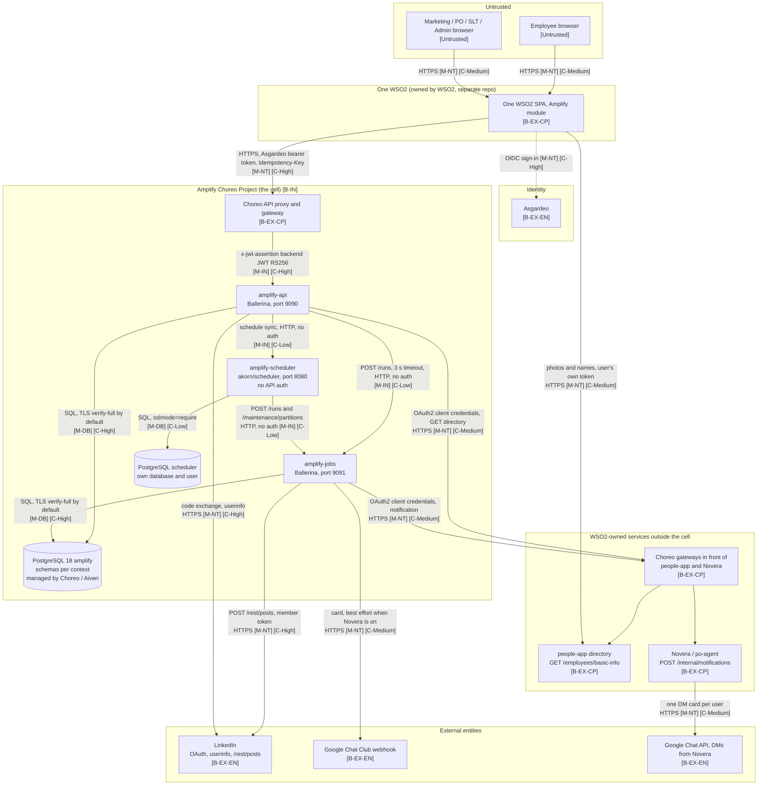

## Diagram 1: Container architecture (local Compose stack)

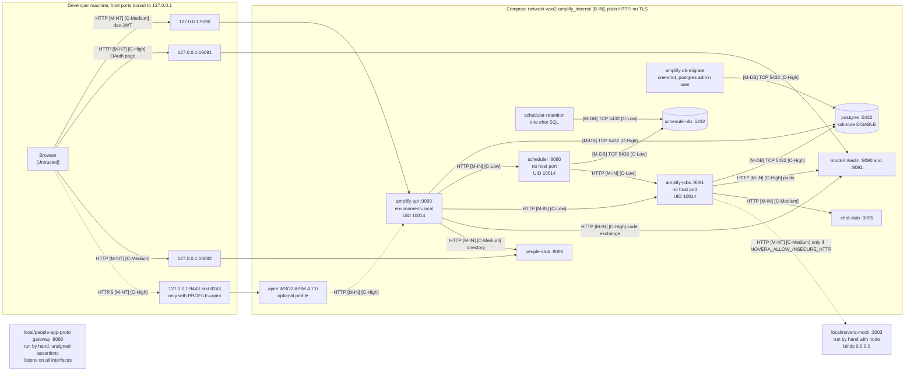

Choreo mapping: each Amplify component is a Choreo Service in one Project. `amplify-api` is published through the Choreo API proxy. `amplify-jobs` and `amplify-scheduler` declare Project visibility in `.choreo/component.yaml` and `workload.yaml` and have no proxy. Whether Choreo enforces that visibility in the deployed environment is not verified here.

## DFD 1: Sign-in and the shared API request path

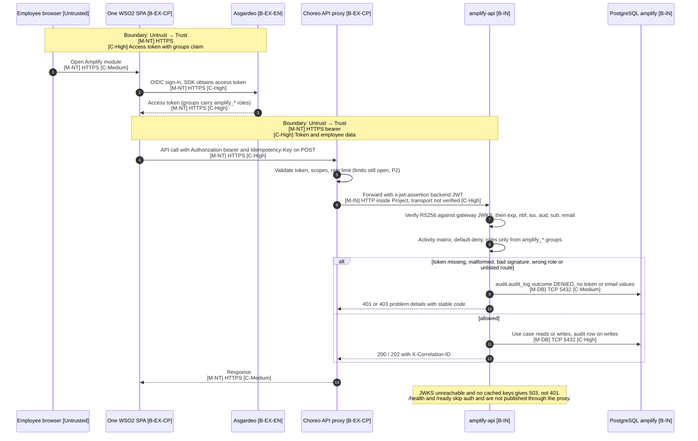

## DFD 2: Connect a LinkedIn account

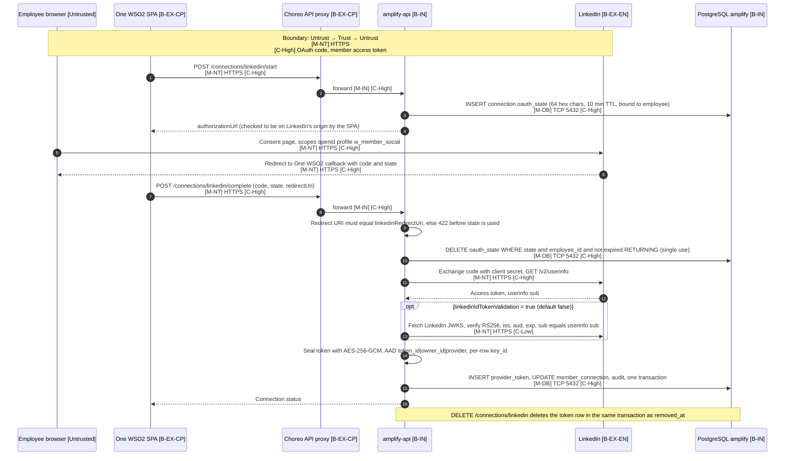

## DFD 3: Register a campaign and announce it (outbox, Novera, Club webhook)

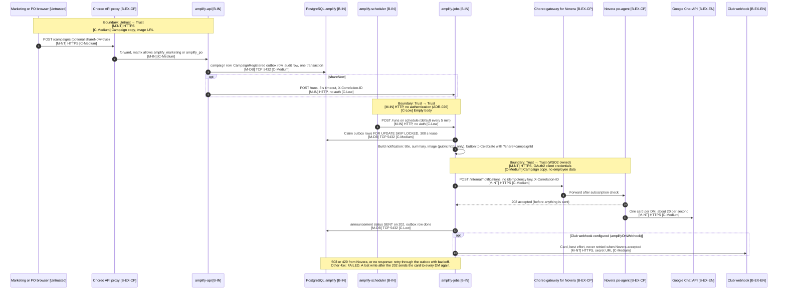

## DFD 4: Share a campaign as a repost

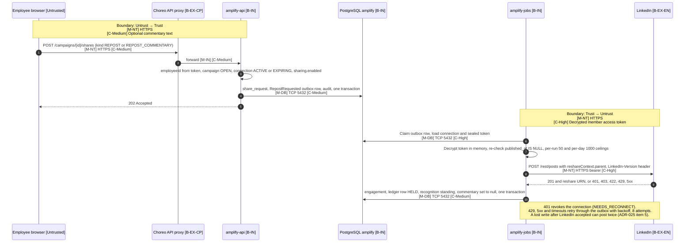

## DFD 5: External share review and PO point corrections

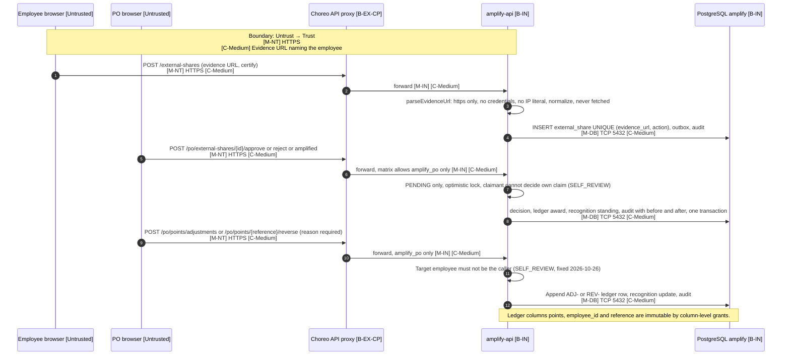

## DFD 6: Admin settings, scheduler sync, run and maintenance

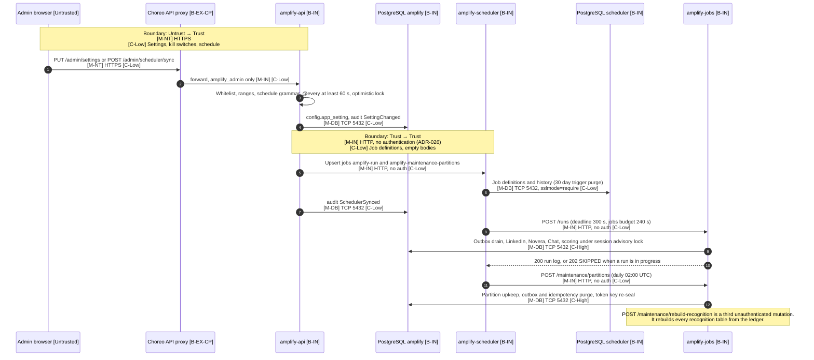

## DFD 7: People directory read, open leaderboards, headcount and weekly top three

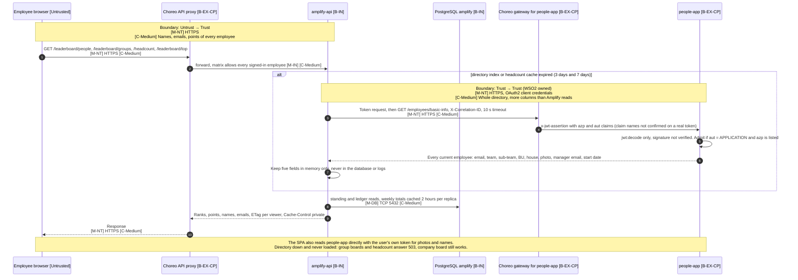

## DFD 8: Role-gated dashboards, person board and CSV export

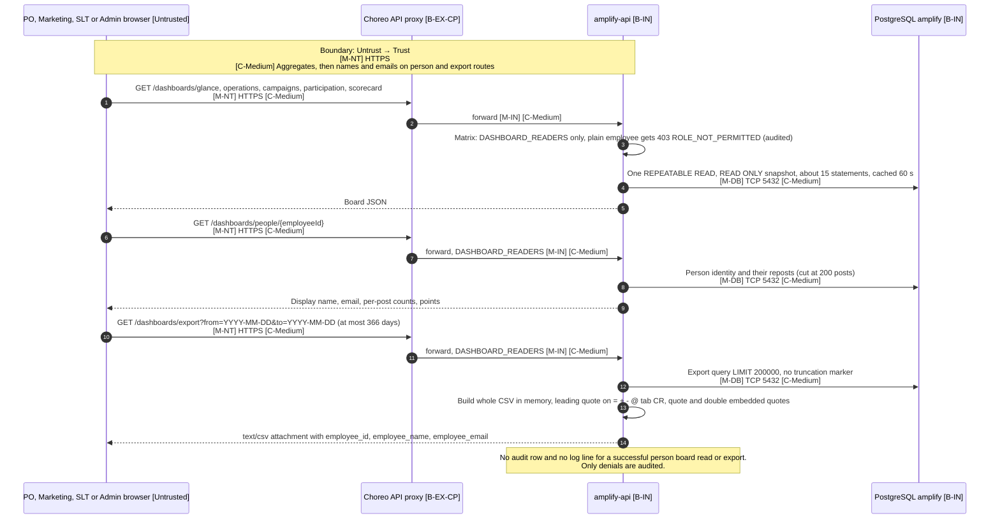

## DFD 9: Local stack sign-in with the dev JWT (environment = local only)

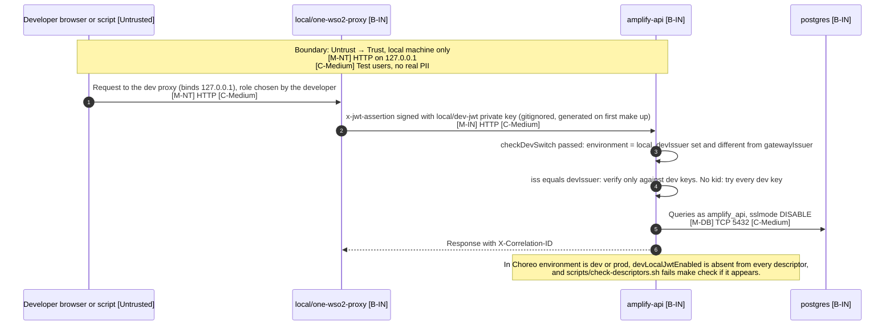

## Summary of boundary crossings

| DFD | Boundary Crossing | Medium | Confidentiality |
|-----|-------------------|--------|-----------------|
| Diagram 0: High-level architecture | All boundaries | [M-NT], [M-IN], [M-DB] | [C-High] tokens and secrets, [C-Medium] employee data |
| Diagram 1: Container architecture (local) | Untrust → Trust (loopback), Trust → Trust | [M-NT], [M-IN], [M-DB] | [C-Medium] test data, [C-High] dev tokens |
| DFD 1: Sign-in and API request path | Untrust → Trust, Trust → Trust | [M-NT] HTTPS, [M-IN], [M-DB] | [C-High] access token and backend JWT |
| DFD 2: Connect LinkedIn | Untrust → Trust, Trust → Untrust | [M-NT] HTTPS, [M-DB] | [C-High] OAuth code and member token |
| DFD 3: Register campaign and announce | Untrust → Trust, Trust → Trust, Trust → Untrust | [M-NT] HTTPS, [M-IN] HTTP, [M-DB] | [C-Medium] campaign copy, [C-High] Novera client secret |
| DFD 4: Share as repost | Untrust → Trust, Trust → Untrust | [M-NT] HTTPS, [M-DB] | [C-High] decrypted member token |
| DFD 5: External share and PO corrections | Untrust → Trust | [M-NT] HTTPS, [M-DB] | [C-Medium] evidence URLs, points, reasons |
| DFD 6: Settings, scheduler, run, maintenance | Untrust → Trust, Trust → Trust | [M-NT] HTTPS, [M-IN] HTTP no auth, [M-DB] | [C-Low] settings, [C-High] tokens handled in jobs |
| DFD 7: Directory read and open leaderboards | Untrust → Trust, Trust → Trust (WSO2 owned) | [M-NT] HTTPS, [M-DB] | [C-Medium] names, emails, points |
| DFD 8: Dashboards, person board, export | Untrust → Trust | [M-NT] HTTPS, [M-DB] | [C-Medium] names and emails in bulk |
| DFD 9: Local dev JWT | Untrust → Trust (loopback only) | [M-NT] HTTP, [M-IN], [M-DB] | [C-Medium] test data |
